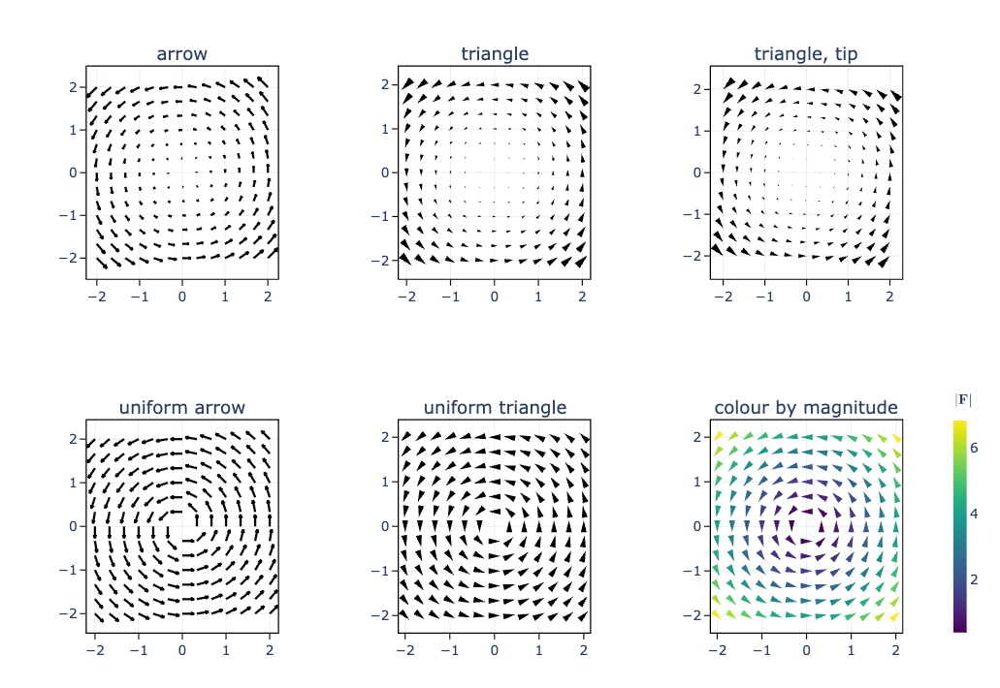

# 2-D fields

## Matrix orientation

The field functions take a matrix indexed `U[ix, iy]`: `U[i, j]` is the value
at `(x[i], y[j])`, and `size(U) == (length(x), length(y))`. Build it with `x`
in the outer loop, or with `meshgrid` (re-exported from MeshGrid.jl), whose
`Y, X = meshgrid(y, x)` gives matrices of that shape:

```julia
using PlotlySupply

xs = range(0, 4; length = 121)
ys = range(0, 2; length = 61)
U = [sin(2x) * cos(3y) for x in xs, y in ys]     # size (121, 61)
Y, X = meshgrid(ys, xs)
@assert U == sin.(2 .* X) .* cos.(3 .* Y)
fig = plot_heatmap(xs, ys, U; xlabel = "\$x\$", ylabel = "\$y\$")
```

A matrix of the wrong shape raises an `ArgumentError`; when it is the
transpose of the expected shape, the message says so. `x` and `y` may also
list the `n + 1` cell edges instead of the `n` cell centres.
`plot_heatmap(U)` uses the indices `0:size(U, 1)-1` and `0:size(U, 2)-1`.

[`plot_matrix`](@ref) is different on purpose: it draws a matrix as printed
(`A[i, j]` in row `i` from the top, column `j`), with the values written in
the cells.

```julia
C = [1.0 0.8 -0.2; 0.8 1.0 0.1; -0.2 0.1 1.0]
fig = plot_matrix(C; xlabels = ["a", "b", "c"], ylabels = ["a", "b", "c"],
    crange = (-1, 1), colorbar_title = "r")
```

## Heatmaps and contours

[`plot_heatmap`](@ref) and [`plot_contour`](@ref) share the colour keywords
(`colorscale`, `crange`, `cmid`, `colornorm`, `levels`, `showscale`,
`colorbar_title`, `colorbar_title_side`, `colorbar_ticks`,
`colorbar_ticklabels`, `coloraxis`; see [Colours](colors.md)). Contours also
take `levels` (a vector of values) or `ncontours`, `coloring` (`"fill"`,
`"lines"`, `"none"`, `"heatmap"`), `showlabels` and `labelformat`.

```julia
fig = plot_heatmap(xs, ys, U; colorscale = "RdBu_r", cmid = 0,
    colorbar_title = "\$u\$")
plot_contour!(fig, xs, ys, U; levels = [0.0], coloring = "none",
    linecolor = "black", linewidth = 1.5)
```

`origin = :upper` puts the first row of `y` at the top (image convention);
`text`/`texttemplate` write values into the cells.

## Tight axes and equal aspect

Axes that carry a field fit the field exactly: the view is the field's extent
(cell edges for a heatmap) with no padding, also after lines or arrows are
drawn on top, as long as their data stays inside it. A range you set yourself,
or `tight = false`, wins. `xrange!(fig, nothing)` returns to the fitted view.

`equalar = true` gives both axes the same scale. For a single figure without
an explicit size, the figure height follows the field's aspect ratio, so no
blank space is left around the field and the colorbar is as tall as the
field.

```julia
fig = plot_heatmap(xs, ys, U; equalar = true, colorscale = "viridis")
plot_scatter!(fig, [1.0, 3.0], [0.5, 1.5]; mode = "markers", color = "red",
    legend = "probes")
```

The fit is written into the layout (as `autorangeoptions` limits, or as an
explicit `range` under `equalar = true`) by every PlotlySupply call that
changes the figure, and again on the copy that `savefig` exports at its final
size. A `Plot` changed only with raw PlotlyBase calls (`relayout!`,
`addtraces!`) keeps its previous fit until the next PlotlySupply call or
export.

## Images

[`plot_image`](@ref) shows an `H x W x 3` (RGB) or `H x W x 4` (RGBA) array,
or a matrix of Colors.jl colours, with row 1 at the top and square pixels.
Channel values follow plotly's convention, 0 to 255 (multiply data in
`[0, 1]` by 255); the alpha channel of a floating-point RGBA array is in
`[0, 1]`. `extent = (x0, x1, y0, y1)` places the image in data coordinates.

```julia
img = zeros(40, 60, 3)
img[:, :, 1] .= 255 .* range(0, 1; length = 60)'
img[:, :, 3] .= 255 .* range(1, 0; length = 40)
fig = plot_image(img; extent = (0, 6, 0, 4), xlabel = "x (mm)", ylabel = "y (mm)")
```

## Unstructured grids and meshes

[`plot_pcolormesh`](@ref) draws quadrilateral cells on a curvilinear grid
(`X`, `Y` node matrices, `C` with one value per cell). [`plot_polygons`](@ref)
draws arbitrary polygons, coloured by a value per polygon or in one colour.
[`plot_tripcolor`](@ref), [`plot_triplot`](@ref) and [`plot_tricontour`](@ref)
work on triangle meshes given by node coordinates and a 1-based
`ntri x 3` connectivity matrix.

```julia
r = range(1, 2; length = 9)
θ = range(0, π; length = 33)
X = [ri * cos(t) for ri in r, t in θ]
Y = [ri * sin(t) for ri in r, t in θ]
C = [sin(3t) / ri for ri in r[1:end-1], t in θ[1:end-1]]
fig = plot_pcolormesh(X, Y, C; colorscale = "RdBu_r", cmid = 0, colorbar_title = "f")
plot_pcolormesh!(fig, -X, Y, C; colorscale = "RdBu_r", cmid = 0, showscale = false)
```

```julia
x = [0.0, 1.0, 0.0, 1.0, 0.5]
y = [0.0, 0.0, 1.0, 1.0, 0.5]
tri = [1 2 5; 2 4 5; 4 3 5; 3 1 5]
f = x .+ y
fig = plot_tripcolor(x, y, tri, f; shading = :gouraud, colorscale = "cividis")
plot_triplot!(fig, x, y, tri; color = "white", linewidth = 1)
plot_tricontour!(fig, x, y, tri, f; levels = [0.5, 1.0, 1.5], color = "black",
    showlabels = true)
```

```julia
px = [[0.0, 1, 1, 0], [1.0, 2, 1.5]]
py = [[0.0, 0, 1, 1], [0.0, 0, 1]]
fig = plot_polygons(px, py, [1.0, 2.0]; colorscale = "viridis",
    colorbar_title = "value")
```

## Vector fields

[`plot_quiver`](@ref) draws one glyph per vector `(u, v)` at `(x, y)`; equal
axis scales are on by default (`equalar = true`). `sizeref` is the length of
the longest glyph in data units (decades on a log axis). Two kinds, chosen by
`style`:

- `style = :arrow` (default): a line arrow whose length is proportional to
  the magnitude.
- `style = :triangle`: one filled isosceles triangle per vector, pointing
  along `(u, v)`; its length and base together are proportional to the
  magnitude. `headwidth` (default 0.5) is the base as a fraction of the length.
  Triangles are polygons in data units, so they scale with the axes like the
  arrows do, and `edgecolor`/`edgewidth` outline them (default: no edge).

Further keywords: `pivot = :tail | :middle | :tip` (the part of the glyph at
`(x, y)`; default `:tail` for arrows, `:middle` for triangles);
`scale = :magnitude` (default) or `:uniform` (every non-zero vector at the
full `sizeref`: a direction field); `colorby = :magnitude`, or an array of
values with the shape of `u`, colours the glyphs through the colour keywords
(`colorscale`, `crange`, `cmid`, `colornorm`, `levels`, `colorbar_title`,
`colorbar_title_side`, `coloraxis`, `showscale`) and draws a colorbar; `color`
is then an error. `scale = :uniform` with `colorby = :magnitude` gives
direction by glyph and strength by colour. `opacity` and `legend` apply as
elsewhere; zero and `NaN` vectors are skipped. [`plot_quiver3d`](@ref) has
`style = :cone` (default) or `:arrow` for the same choice in 3-D.

```julia
gx = range(-2, 2; length = 13)
qx = vec([x for x in gx, y in gx])
qy = vec([y for x in gx, y in gx])
u = -qy .* (1 .+ 0.5 .* hypot.(qx, qy))
v = qx .* (1 .+ 0.5 .* hypot.(qx, qy))
fig_quiver = subplots(2, 3; sync = false, width = 900, height = 620,
    subplot_titles = ["arrow", "triangle", "triangle, tip", "uniform arrow",
        "uniform triangle", "colour by magnitude"])
plot_quiver!(fig_quiver, qx, qy, u, v; row = 1, col = 1, sizeref = 0.5, color = "black")
plot_quiver!(fig_quiver, qx, qy, u, v; row = 1, col = 2, style = :triangle, sizeref = 0.5,
    color = "black")
plot_quiver!(fig_quiver, qx, qy, u, v; row = 1, col = 3, style = :triangle, pivot = :tip,
    sizeref = 0.5, color = "black")
plot_quiver!(fig_quiver, qx, qy, u, v; row = 2, col = 1, scale = :uniform, sizeref = 0.4,
    color = "black")
plot_quiver!(fig_quiver, qx, qy, u, v; row = 2, col = 2, style = :triangle, scale = :uniform,
    sizeref = 0.4, color = "black")
plot_quiver!(fig_quiver, qx, qy, u, v; row = 2, col = 3, style = :triangle, scale = :uniform,
    sizeref = 0.4, colorby = :magnitude, colorscale = "viridis", colorbar_title = "\$|\\mathbf{F}|\$")
```



An overlay does not widen the tight axes of a field under it: a quiver or
streamline overlay contributes its anchor points (the positions of the
glyphs, the seed grid of streamlines), not the length of its arrows. Anchors
inside the field leave the axes tight on the field, and the part of an arrow
beyond the frame is clipped (as in matplotlib); `pivot = :tip` or an explicit
`xrange`/`yrange` shows arrows whole. A quiver or streamline plot without a
field under it autoranges on what it draws, with the normal padding.

[`plot_streamlines`](@ref) integrates streamlines of a gridded field
`U[ix, iy]`, `V[ix, iy]`; `colorby = :speed` colours them by speed with a
colorbar. The arrowheads are filled in the line colour.

```julia
sx = range(-2, 2; length = 41)
sy = range(-1, 1; length = 21)
Us = [-y for x in sx, y in sy]
Vs = [x for x in sx, y in sy]
fig = plot_heatmap(sx, sy, hypot.(Us, Vs); colorscale = "Greys", showscale = false)
plot_streamlines!(fig, sx, sy, Us, Vs; colorby = :speed, colorscale = "viridis",
    colorbar_title = "speed")
```

## Other field options

- One-sided limits work on field axes like anywhere else (`xrange = (0, nothing)`;
  see [Axes and ticks](axes.md)). On equal-aspect and image axes the limit pins
  the range to `[bound, the data's current far edge]`, as matplotlib's
  `set_xlim` does, and that edge does not follow data added later.
  An image's y axis keeps plotly's reversed default, also in subplot cells.
- `interpolation = :bilinear` smooths a heatmap (`zsmooth = "best"`) or an
  image (a PNG source with smoothing; linear axes only, and hover shows the
  RGBA pixel).
- [`plot_pcolormesh`](@ref) defaults to `equalar = false` (matplotlib's `auto`
  aspect); pass `equalar = true` for a physical-space mesh and check that a
  circle is round.
- Contours with non-uniform `levels` colour each level and add no legend
  entries.
- `plot_matrix` and the mesh functions (`plot_pcolormesh`, `plot_polygons`,
  `plot_tripcolor`, `plot_triplot`, `plot_tricontour`) take `xticks`, `yticks`,
  `xticklabels`, `yticklabels`, `xtickformat` and `ytickformat`.
- `shared_colorbar!` honours the members' explicit colour limits
  (`zrange = (-1, 1)` keeps the tick at -1), and a second colour-mapped trace
  on the same axes (contour over heatmap) draws its own bar beside the first.
