# Gallery

The figures below are drawn by the scripts in `docs/gallery/`. Each script is
self-contained (synthetic data computed in the script), a header comment says what it
shows, which matplotlib idiom it replaces and which PlotlySupply calls replace it, and
`julia --project=. docs/gallery/runall.jl [outdir]` renders all of them (each in its own
module; the exit status is 1 if one fails). A script writes its PNG next to itself, or
to the directory given as its first argument. Fonts, line weights and sizes come from
a journal preset (`with_style(:ieee)`, `figsize!(fig, :ieee; columns = 2)`), not from
hand-set numbers; every figure is rendered at 2x.

The scripts cover the figure types of three research projects: finite-element convergence
studies, field maps with shared colorbars, deformed meshes, 3-D surfaces and tori, schematics,
bar charts, ECDFs, annotated heatmaps, pixel maps and optimisation histories. No script computes
a pixel position by hand; the few offsets are `annotate!`'s own `offset` from a data point.

## Convergence studies and line plots

### `chama_a1_eigenvalue_study`

Two-panel log-log eigenvalue study with one figure legend below the panels. ([script](https://github.com/jake-w-liu/PlotlySupply.jl/blob/main/docs/gallery/chama_a1_eigenvalue_study.jl))

### `chama_a2_infsup`

Inf-sup study: filled versus open markers, shared y axis, O(h^2) guide, legend on top. ([script](https://github.com/jake-w-liu/PlotlySupply.jl/blob/main/docs/gallery/chama_a2_infsup.jl))

### `chama_a3_partial_load`

Converged points with lines, unconverged points as crosses, on a log x axis. ([script](https://github.com/jake-w-liu/PlotlySupply.jl/blob/main/docs/gallery/chama_a3_partial_load.jl))

### `chama_a4_load_paths`

Load-displacement paths: colour = method, line style = mesh, event markers, mixed legend. ([script](https://github.com/jake-w-liu/PlotlySupply.jl/blob/main/docs/gallery/chama_a4_load_paths.jl))

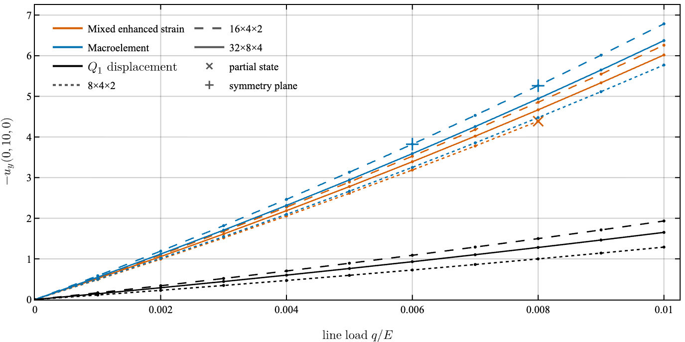

### `audit_b_reference_markers`

Computed curves with hollow reference markers on top and a partial-load cross. ([script](https://github.com/jake-w-liu/PlotlySupply.jl/blob/main/docs/gallery/audit_b_reference_markers.jl))

### `mdd_regimes`

Three panels of error and norm curves against a subdivision count, one legend row below. ([script](https://github.com/jake-w-liu/PlotlySupply.jl/blob/main/docs/gallery/mdd_regimes.jl))

### `mdd_convergence_band`

h- and p-refinement: hollow experiment markers, formula lines, a min/max band, a guide. ([script](https://github.com/jake-w-liu/PlotlySupply.jl/blob/main/docs/gallery/mdd_convergence_band.jl))

### `mdd_theory_vs_data`

Theory lines against hollow-marker data, with a shorter residual row of stems below. ([script](https://github.com/jake-w-liu/PlotlySupply.jl/blob/main/docs/gallery/mdd_theory_vs_data.jl))

### `topo_convergence`

Convergence with slope guides and a numerical-floor band, beside a work-accuracy plot. ([script](https://github.com/jake-w-liu/PlotlySupply.jl/blob/main/docs/gallery/topo_convergence.jl))

### `optical_tolerance`

Reference line on log-log axes, nested tolerance bands, and a secondary axis in nanometres. ([script](https://github.com/jake-w-liu/PlotlySupply.jl/blob/main/docs/gallery/optical_tolerance.jl))

### `optical_ecdf`

Quantile curves with outlined stars, a step ECDF with a tick strip, and residuals on a semilog axis. ([script](https://github.com/jake-w-liu/PlotlySupply.jl/blob/main/docs/gallery/optical_ecdf.jl))

### `optimization_history`

Optimization histories with fading seeds beside categorical end points with rotated labels. ([script](https://github.com/jake-w-liu/PlotlySupply.jl/blob/main/docs/gallery/optimization_history.jl))

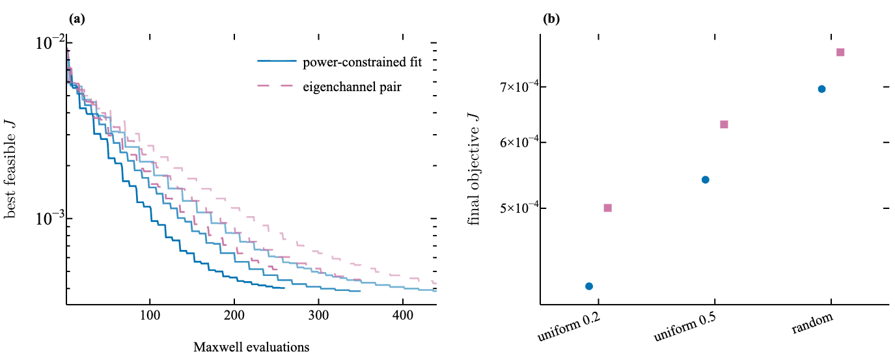

### `sharey_crossover`

Two panels sharing y on a log x axis, hollow samples over limit curves, one legend above. ([script](https://github.com/jake-w-liu/PlotlySupply.jl/blob/main/docs/gallery/sharey_crossover.jl))

### `band_quasimodes`

Residual decay on a wide semilog axis with a leader label, and a min/max band of four curves. ([script](https://github.com/jake-w-liu/PlotlySupply.jl/blob/main/docs/gallery/band_quasimodes.jl))

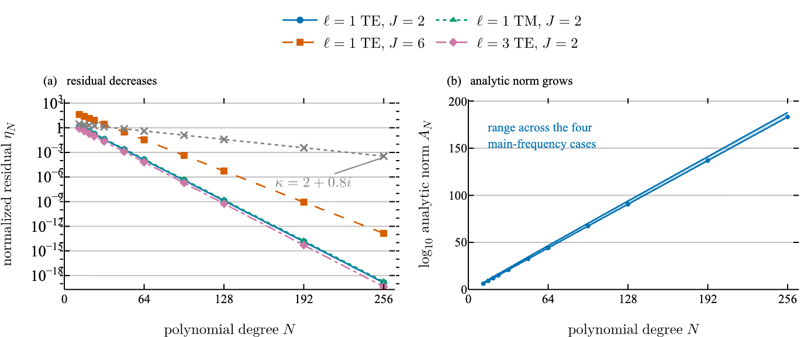

### `endpoint_star`

Two series with their extrapolated end points drawn as stars. ([script](https://github.com/jake-w-liu/PlotlySupply.jl/blob/main/docs/gallery/endpoint_star.jl))

### `poles_scatter`

Poles in the complex plane: filled and hollow markers, a label next to every point. ([script](https://github.com/jake-w-liu/PlotlySupply.jl/blob/main/docs/gallery/poles_scatter.jl))

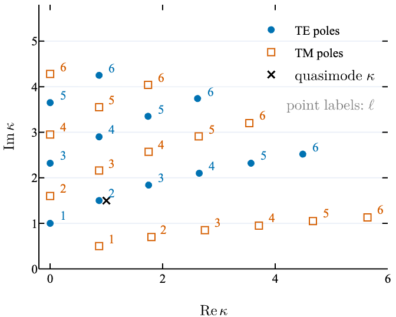

### `topo_phase`

A phase-plane schematic with arcs and leader labels, beside a phase-lag plot. ([script](https://github.com/jake-w-liu/PlotlySupply.jl/blob/main/docs/gallery/topo_phase.jl))

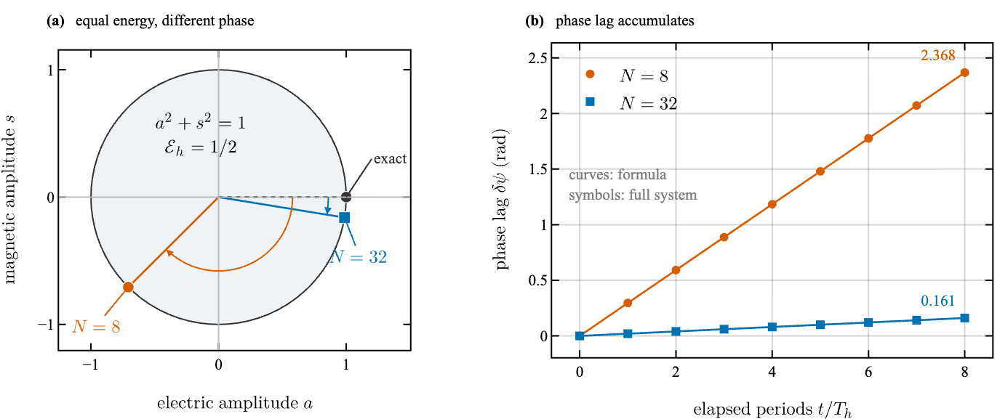

## Bars, dots and heatmaps

### `log_bars`

Grouped bars on a log y axis beside a line plot with a dotted floor. ([script](https://github.com/jake-w-liu/PlotlySupply.jl/blob/main/docs/gallery/log_bars.jl))

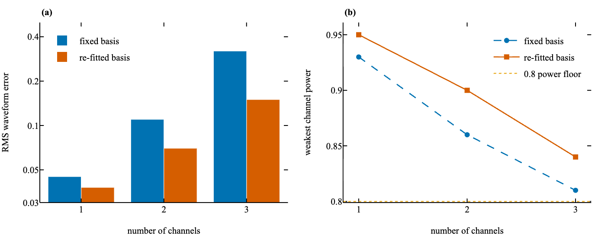

### `optical_bars`

Horizontal bars on a log axis with conditional value labels, and a stacked power budget. ([script](https://github.com/jake-w-liu/PlotlySupply.jl/blob/main/docs/gallery/optical_bars.jl))

### `optical_dots`

Dots at grouped categorical positions: filled and hollow markers, group names under the ticks. ([script](https://github.com/jake-w-liu/PlotlySupply.jl/blob/main/docs/gallery/optical_dots.jl))

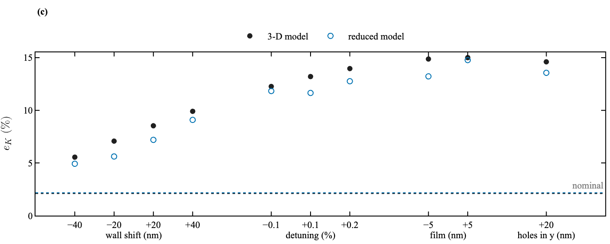

### `param_heatmaps`

Two parameter-space heatmaps with a shared y axis and one colorbar. ([script](https://github.com/jake-w-liu/PlotlySupply.jl/blob/main/docs/gallery/param_heatmaps.jl))

### `topo_annotated_heatmap`

A heatmap with two labels in every cell, beside a log-log companion. ([script](https://github.com/jake-w-liu/PlotlySupply.jl/blob/main/docs/gallery/topo_annotated_heatmap.jl))

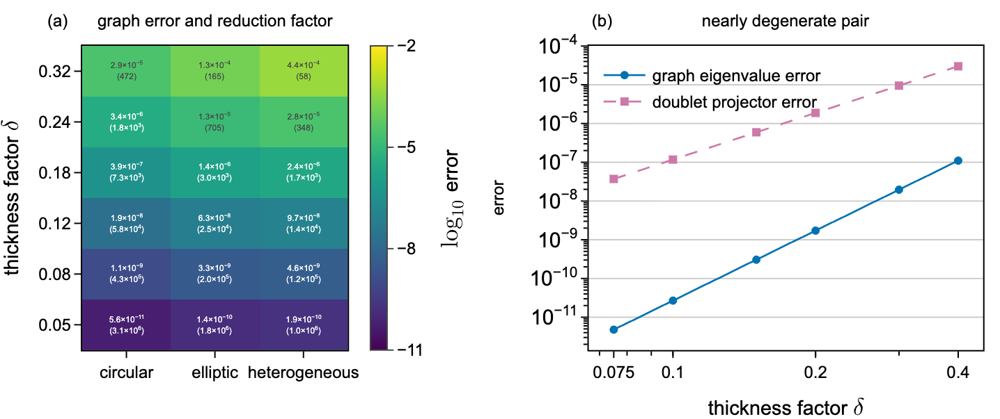

### `optical_cividis`

Cividis maps with outlined holes and one colorbar, a smoothed error map, a log-scaled matrix. ([script](https://github.com/jake-w-liu/PlotlySupply.jl/blob/main/docs/gallery/optical_cividis.jl))

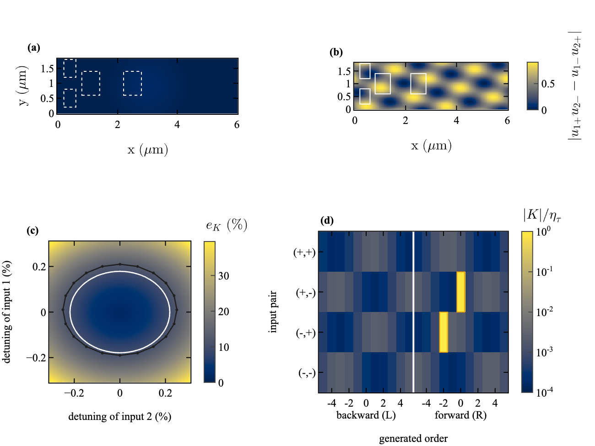

*Known limit at the time of writing: the two maps of the first row differ in size because the shared colorbar takes its room from the right-hand cell.*

### `topo_pcolormesh`

A diverging strip with a power-of-ten colorbar, log-y cell edges, and a curvilinear cross-section. ([script](https://github.com/jake-w-liu/PlotlySupply.jl/blob/main/docs/gallery/topo_pcolormesh.jl))

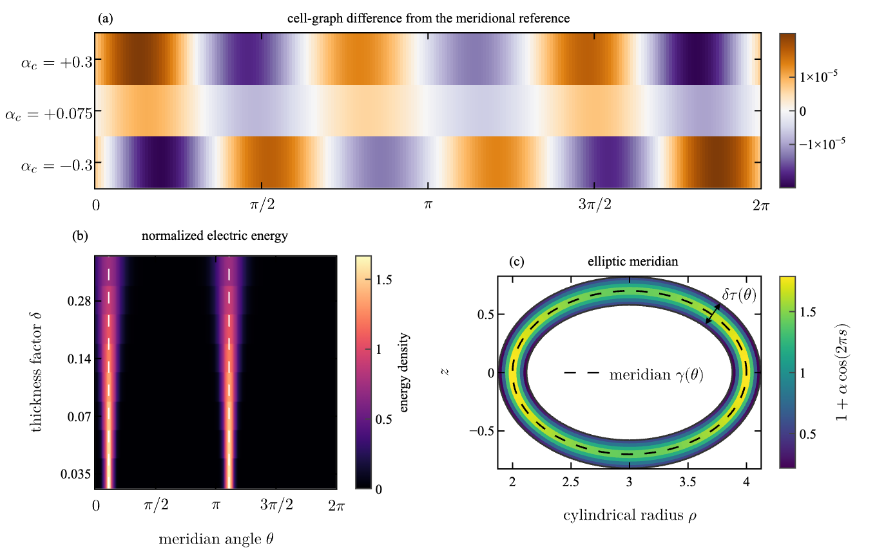

### `optical_pixelmap`

A binary pixel pattern drawn cell by cell with wave-vector arrows, and the same pattern as image rows. ([script](https://github.com/jake-w-liu/PlotlySupply.jl/blob/main/docs/gallery/optical_pixelmap.jl))

## Field maps and meshes

### `fig4_waveguide`

A six-panel waveguide figure: signed field, current with streamlines and mode content, two columns. ([script](https://github.com/jake-w-liu/PlotlySupply.jl/blob/main/docs/gallery/fig4_waveguide.jl))

### `field_maps`

Stacked intensity maps on a non-uniform grid, one colorbar for all three. ([script](https://github.com/jake-w-liu/PlotlySupply.jl/blob/main/docs/gallery/field_maps.jl))

### `chama_a5_deformed_meshes`

Three deformed FEM quad meshes coloured by a cell value, one shared colorbar. ([script](https://github.com/jake-w-liu/PlotlySupply.jl/blob/main/docs/gallery/chama_a5_deformed_meshes.jl))

*Known limit at the time of writing: the x labels of equal-aspect cells sit at the bottom of the cell, below a plot that is smaller than the cell.*

### `chama_a6_map_and_curves`

A deformed-mesh field map beside a curve panel, the colorbar bound to the map only. ([script](https://github.com/jake-w-liu/PlotlySupply.jl/blob/main/docs/gallery/chama_a6_map_and_curves.jl))

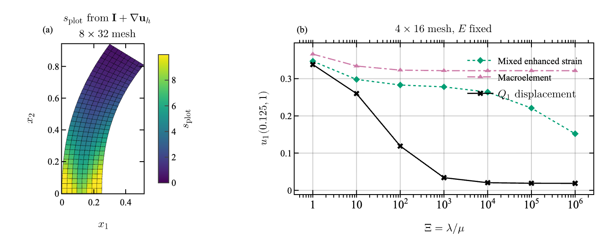

*Known limit at the time of writing: the default legend of panel (b) covers part of a curve, and the x label of the map sits low.*

### `tripcolor_geometry`

A geometry sketch beside a Gouraud-shaded field on an unstructured triangle mesh. ([script](https://github.com/jake-w-liu/PlotlySupply.jl/blob/main/docs/gallery/tripcolor_geometry.jl))

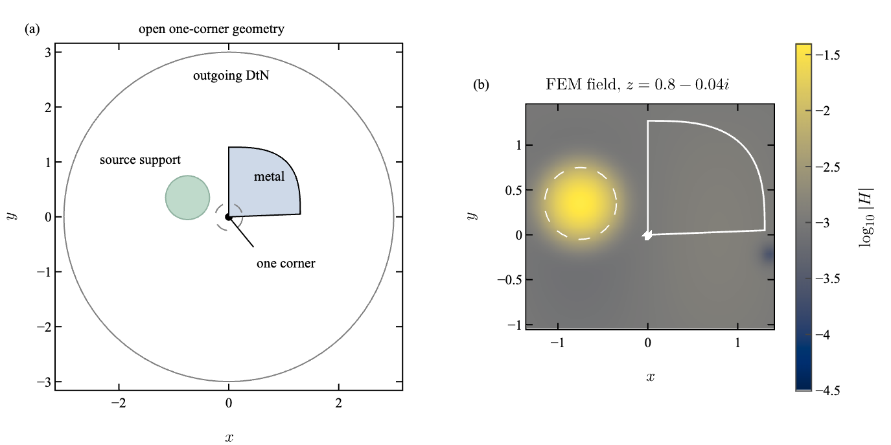

*Known limit at the time of writing: the colorbar of panel (b) is taller than the fitted plot.*

### `mdd_shell_field`

A polar field drawn on a mirrored meridional disk with circles and a text core, beside branches. ([script](https://github.com/jake-w-liu/PlotlySupply.jl/blob/main/docs/gallery/mdd_shell_field.jl))

### `mesh_timeseries_strip`

A mesh schematic beside a time trace with sampled hollow markers and an energy plot. ([script](https://github.com/jake-w-liu/PlotlySupply.jl/blob/main/docs/gallery/mesh_timeseries_strip.jl))

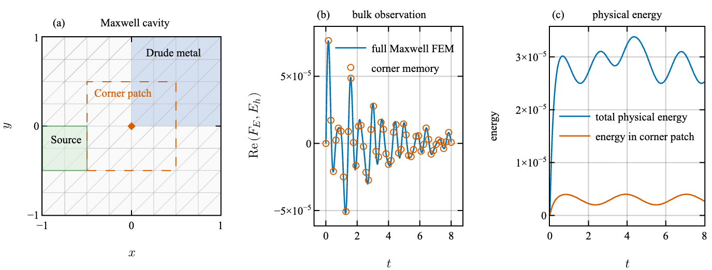

## Schematics

### `block_diagram`

A block diagram on hidden axes above a device drawing with shaded design regions. ([script](https://github.com/jake-w-liu/PlotlySupply.jl/blob/main/docs/gallery/block_diagram.jl))

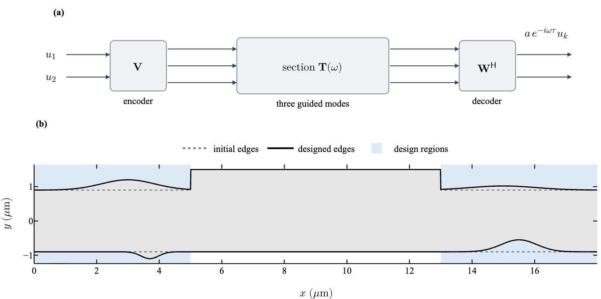

### `device_geometry`

A waveguide device schematic with hatched walls, design strips and dimension arrows, then to scale. ([script](https://github.com/jake-w-liu/PlotlySupply.jl/blob/main/docs/gallery/device_geometry.jl))

### `mdd_schematic`

A schematic of circles, arrows and math labels above two data panels. ([script](https://github.com/jake-w-liu/PlotlySupply.jl/blob/main/docs/gallery/mdd_schematic.jl))

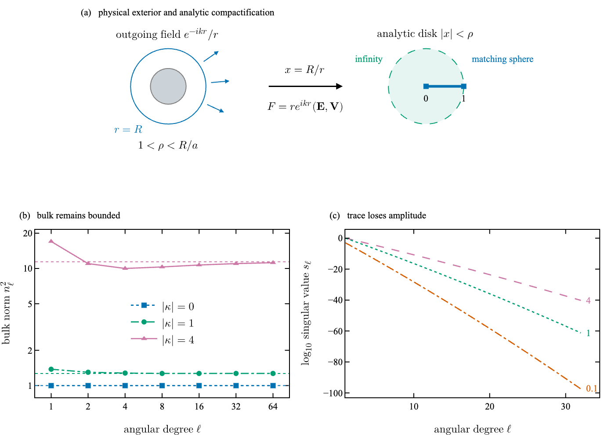

## Three-dimensional figures

### `chama_a7_hex_surfaces`

Exterior faces of three deformed hexahedral meshes, coloured by a displacement, one colorbar. ([script](https://github.com/jake-w-liu/PlotlySupply.jl/blob/main/docs/gallery/chama_a7_hex_surfaces.jl))

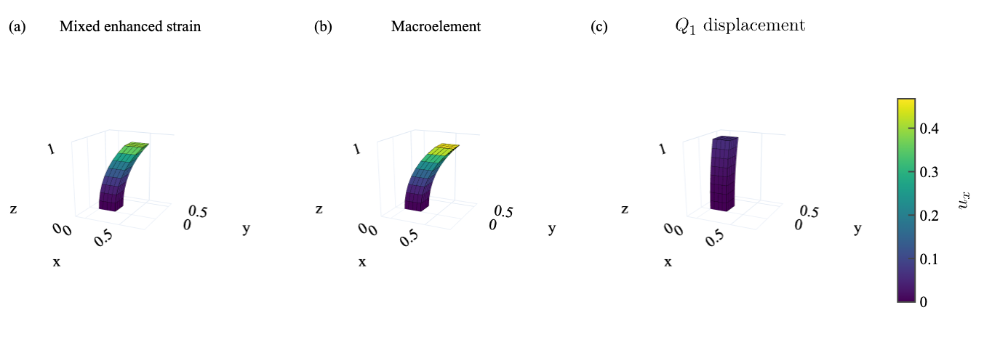

*Known limit at the time of writing: a 3-D scene fills only part of its grid cell.*

### `chama_a8_geometry_sketch`

A single-colour 3-D geometry sketch with a label at a 3-D point. ([script](https://github.com/jake-w-liu/PlotlySupply.jl/blob/main/docs/gallery/chama_a8_geometry_sketch.jl))

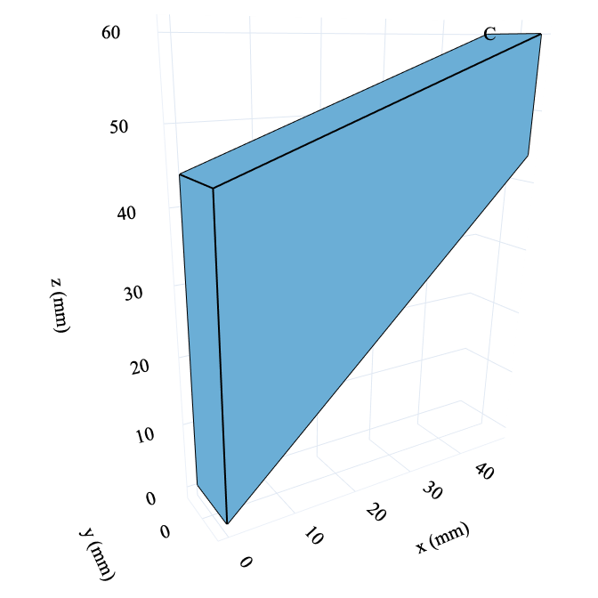

### `chama_a9_torus_ghost_mesh`

A torus coloured by a signed displacement over a faint wireframe of the reference mesh. ([script](https://github.com/jake-w-liu/PlotlySupply.jl/blob/main/docs/gallery/chama_a9_torus_ghost_mesh.jl))

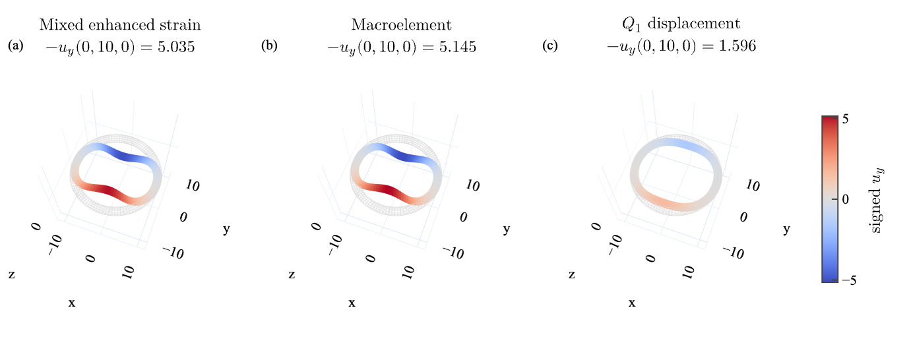

*Known limit at the time of writing: a 3-D scene fills only part of its grid cell.*

### `mdd_slices`

Three horizontal slices of a field in a unit cube, with the cube wireframe and a vector arrow. ([script](https://github.com/jake-w-liu/PlotlySupply.jl/blob/main/docs/gallery/mdd_slices.jl))

*Known limit at the time of writing: a 3-D scene fills only part of its grid cell.*

### `topo_cutplanes`

Three orthogonal cut planes through a unit cube in two scenes, one shared colorbar. ([script](https://github.com/jake-w-liu/PlotlySupply.jl/blob/main/docs/gallery/topo_cutplanes.jl))

### `topo_whitney`

Whitney basis functions on a reference tetrahedron: edges, a face, vector fields and a normal. ([script](https://github.com/jake-w-liu/PlotlySupply.jl/blob/main/docs/gallery/topo_whitney.jl))

*Known limit at the time of writing: a 3-D scene fills only part of its grid cell.*

### `topo_response`

An analytic response surface with 3-D curves and samples, beside an equal-aspect ellipse. ([script](https://github.com/jake-w-liu/PlotlySupply.jl/blob/main/docs/gallery/topo_response.jl))

*Known limit at the time of writing: the 3-D scene in a grid cell is small and its axis titles are close to the tick labels.*

## Layouts and export for journals

### `optical_reach`

Two stacked panels sharing x beside one tall panel, with titled legends and offset labels. ([script](https://github.com/jake-w-liu/PlotlySupply.jl/blob/main/docs/gallery/optical_reach.jl))

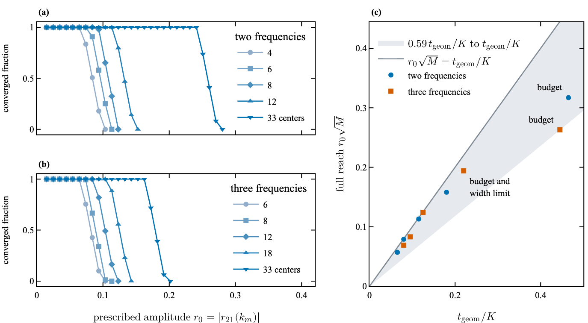

### `journal_export`

A two-panel figure at a journal's text width, exported tight and byte-identical. ([script](https://github.com/jake-w-liu/PlotlySupply.jl/blob/main/docs/gallery/journal_export.jl))

