# Gallery

The figures below are drawn by the scripts in `docs/gallery/`. Each script is
self-contained (synthetic data computed in the script), a header comment says what it
shows, which matplotlib idiom it replaces and which PlotlySupply calls replace it, and
`julia --project=. docs/gallery/runall.jl [outdir]` renders all of them (each in its own
module; the exit status is 1 if one fails). A script writes its PNG next to itself, or
to the directory given as its first argument. Fonts, line weights and sizes come from
a journal preset (`with_style(:ieee)`, `figsize!(fig, :ieee; columns = 2)`), not from
hand-set numbers; every figure is rendered at 2x.

The scripts cover the figure types of three research projects: finite-element convergence
studies, field maps with shared colorbars, deformed meshes, 3-D surfaces and tori, schematics,
bar charts, ECDFs, annotated heatmaps, pixel maps and optimisation histories. No script computes
a pixel position by hand; the few offsets are `annotate!`'s own `offset` from a data point.

## Convergence studies and line plots

### `chama_a1_eigenvalue_study`

Two-panel log-log eigenvalue study with one figure legend below the panels. ([script](https://github.com/jake-w-liu/PlotlySupply.jl/blob/main/docs/gallery/chama_a1_eigenvalue_study.jl))

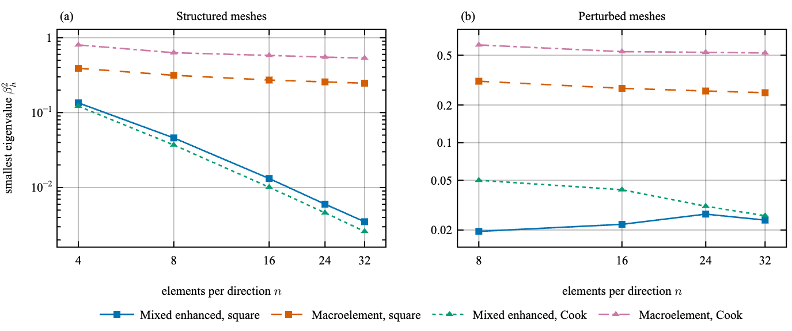

**Replaces (matplotlib):** plt.subplots(1, 2) with set\_xscale/set\_yscale('log'), LogLocator(subs=(1, 2, 5)), FuncFormatter('{:g}'), Line2D proxy handles and fig.legend(loc='lower center', ncol=4).

**PlotlySupply:** named series feed one figure legend, `subs`/`format` give the 1-2-5 ticks and a journal preset sets fonts, line weights and the size.

### `chama_a2_infsup`

Inf-sup study: filled versus open markers, shared y axis, O(h^2) guide, legend on top. ([script](https://github.com/jake-w-liu/PlotlySupply.jl/blob/main/docs/gallery/chama_a2_infsup.jl))

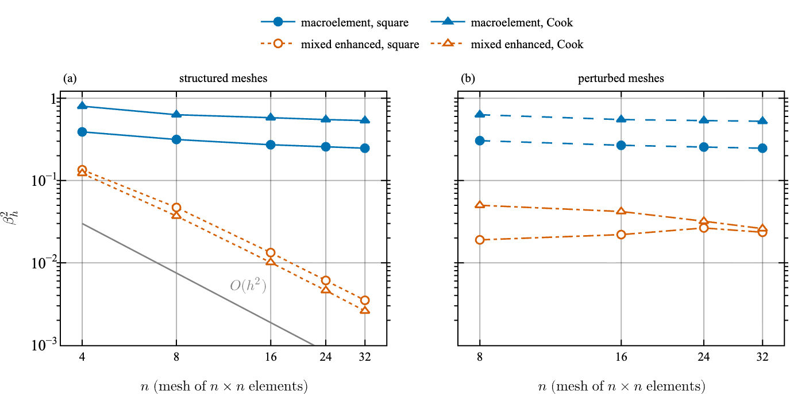

**Replaces (matplotlib):** plt.subplots(1, 2, sharey=True), loglog with mfc='white' markers, ax.text('\$O(h^2)\$') on a two-point reference line, minorticks\_off, fig.legend(loc='upper center', ncol=2).

**PlotlySupply:** `marker_color = "white"` makes the open markers, `slope_guide!` draws and labels the reference slope, `:outside_top` stacks the legend above the panel titles.

### `chama_a3_partial_load`

Converged points with lines, unconverged points as crosses, on a log x axis. ([script](https://github.com/jake-w-liu/PlotlySupply.jl/blob/main/docs/gallery/chama_a3_partial_load.jl))

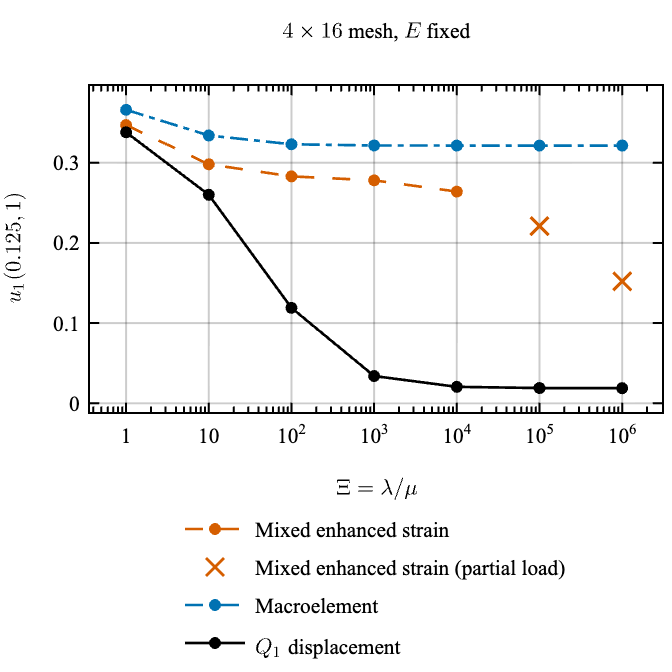

**Replaces (matplotlib):** ax.plot(x, y, '-o') plus ax.plot(x, y, 'x'), set\_xscale('log'), FuncFormatter decade labels and ax.legend(bbox\_to\_anchor=...) pinned inside the axes.

**PlotlySupply:** `xticks = :decades` labels powers of ten; the default legend position avoids the data, so nothing is pinned.

### `chama_a4_load_paths`

Load-displacement paths: colour = method, line style = mesh, event markers, mixed legend. ([script](https://github.com/jake-w-liu/PlotlySupply.jl/blob/main/docs/gallery/chama_a4_load_paths.jl))

**Replaces (matplotlib):** ax.plot(color=, linestyle=), 'x'/'+' marker overlays, ax.set\_xlim(0, 1.025\*ratio), ax.set\_ylim(bottom=0), ticklabel\_format(style='plain') and a legend of grey Line2D proxies.

**PlotlySupply:** one-sided limits (`yrange = (0, nothing)`), `legend_entry!` for the grey line-style keys.

### `audit_b_reference_markers`

Computed curves with hollow reference markers on top and a partial-load cross. ([script](https://github.com/jake-w-liu/PlotlySupply.jl/blob/main/docs/gallery/audit_b_reference_markers.jl))

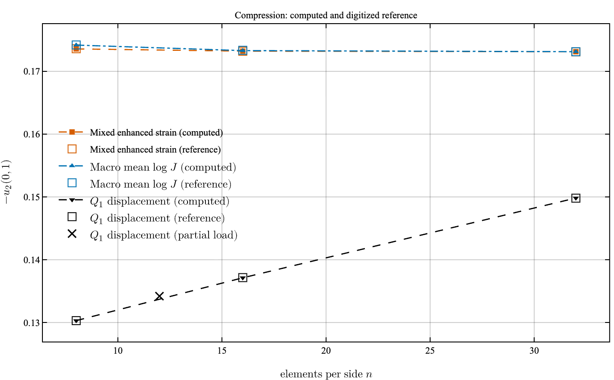

**Replaces (matplotlib):** ax.plot('-o'), ax.plot('s', mfc='none'), ax.plot('x'), ax.grid(alpha=.2) and ax.legend(loc='lower right') on constrained\_layout.

**PlotlySupply:** `marker_color = "none"` gives the hollow squares; no legend position is pinned, the default legend avoids the data.

### `mdd_regimes`

Three panels of error and norm curves against a subdivision count, one legend row below. ([script](https://github.com/jake-w-liu/PlotlySupply.jl/blob/main/docs/gallery/mdd_regimes.jl))

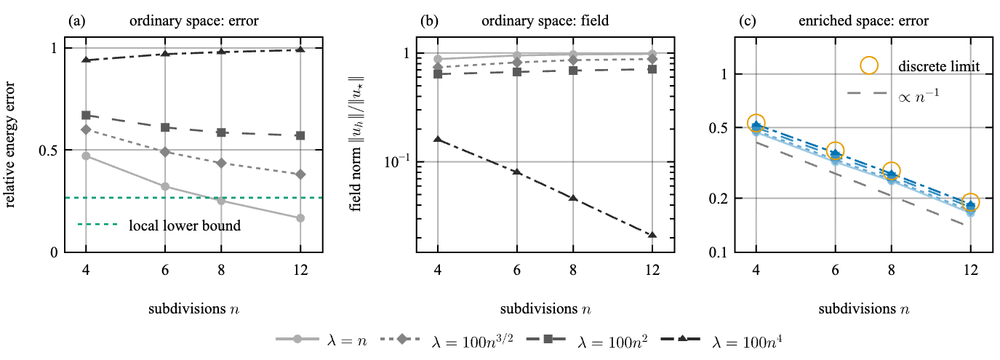

**Replaces (matplotlib):** ax.plot with a shade, marker and line style per series, set\_xscale('log', base=2), per-panel legends, big open circles, a dashed 1/n reference and fig.legend(loc='lower center').

**PlotlySupply:** `lighten` makes the shades, per-panel legends come from named traces, the shared legend is built with `legend_entry!` and sits below the panels without tight\_layout!.

### `mdd_convergence_band`

h- and p-refinement: hollow experiment markers, formula lines, a min/max band, a guide. ([script](https://github.com/jake-w-liu/PlotlySupply.jl/blob/main/docs/gallery/mdd_convergence_band.jl))

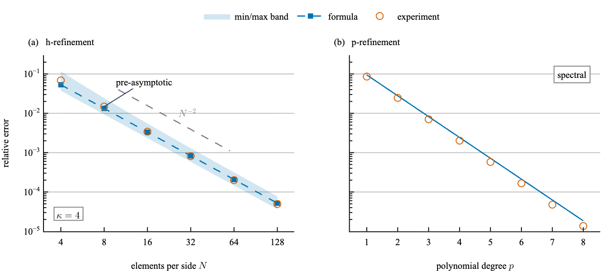

**Replaces (matplotlib):** loglog with mfc='none', fill\_between, markevery=8, a dashed N^-2 guide with ax.text, ax.annotate(arrowprops=...), a boxed ax.text in axes coordinates, open spines, a legend row above.

**PlotlySupply:** `plot_band!`, `markevery`, `slope_guide!`, `annotate!` with an offset and a background box, `spines!(:open)` and one figure legend stacked above the panel titles.

### `mdd_theory_vs_data`

Theory lines against hollow-marker data, with a shorter residual row of stems below. ([script](https://github.com/jake-w-liu/PlotlySupply.jl/blob/main/docs/gallery/mdd_theory_vs_data.jl))

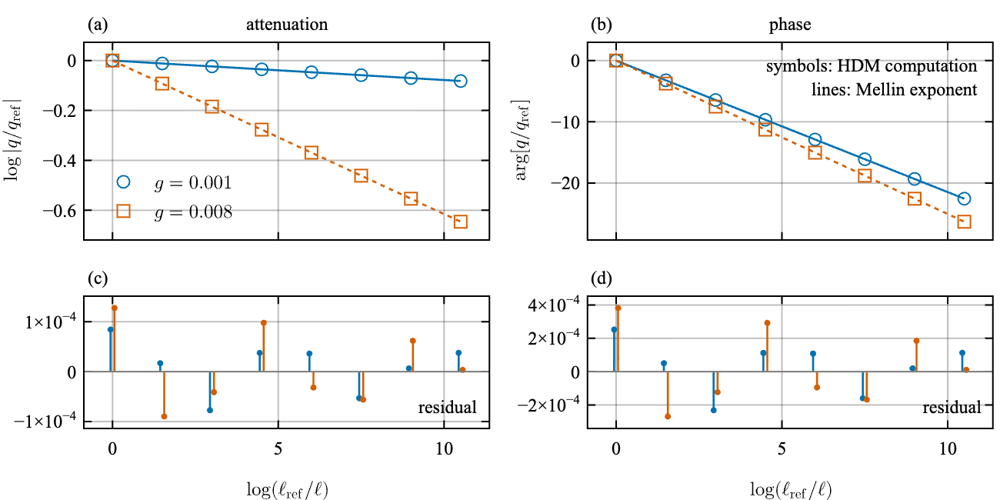

**Replaces (matplotlib):** plt.subplots(2, 2, sharex='col', height\_ratios=\[1.5, 1\]), ax.plot(x\[::3\], y\[::3\], 'o', mfc='none'), ax.vlines stems, tick\_params(direction='in'), a boxed ax.text in axes coordinates.

**PlotlySupply:** `height_ratios`, `shared_xaxes = "columns"`, `plot_vlines!` stems and an `annotate!` box; inward ticks and the box frame come from the journal preset.

### `topo_convergence`

Convergence with slope guides and a numerical-floor band, beside a work-accuracy plot. ([script](https://github.com/jake-w-liu/PlotlySupply.jl/blob/main/docs/gallery/topo_convergence.jl))

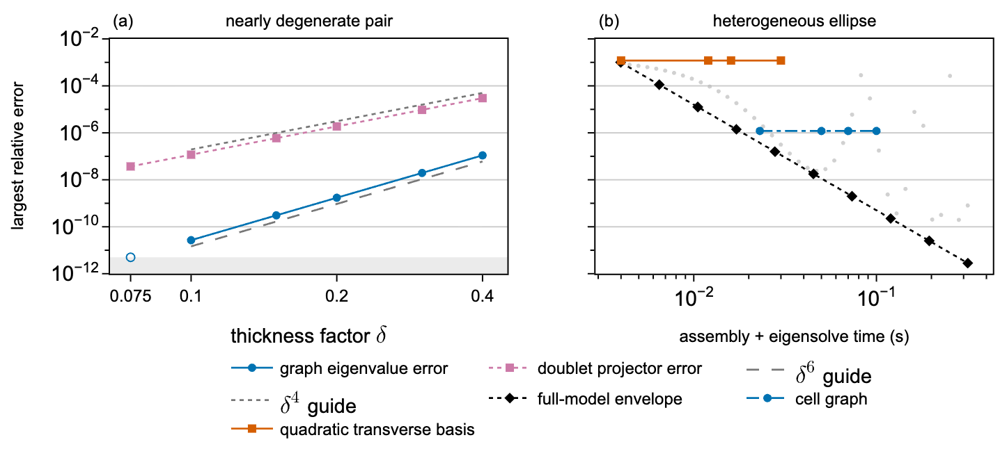

**Replaces (matplotlib):** loglog with o-/s- series, dashed and dotted slope guides in the legend, an unresolved value as a white marker at the floor, axhspan, fig.supylabel and one figure legend below.

**PlotlySupply:** `slope_guide!(legend = ...)`, `hspan!` for the floor, `y_title` for the shared y title, a NaN gap for the unresolved point, and `:outside_bottom` for the figure legend.

### `optical_tolerance`

Reference line on log-log axes, nested tolerance bands, and a secondary axis in nanometres. ([script](https://github.com/jake-w-liu/PlotlySupply.jl/blob/main/docs/gallery/optical_tolerance.jl))

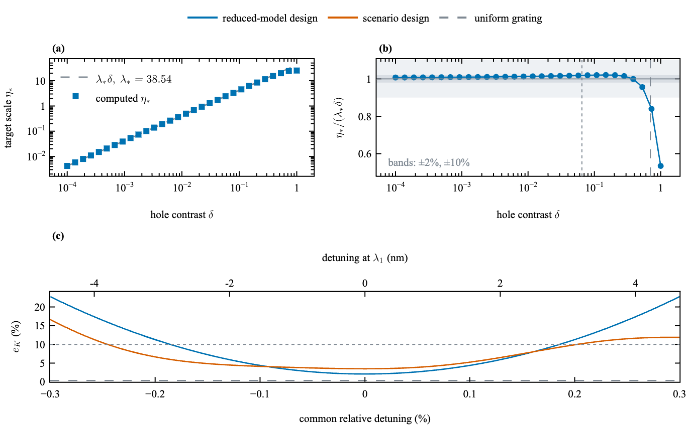

**Replaces (matplotlib):** GridSpec(2, 2) with a full-width bottom panel, axhspan, axvline, ax.secondary\_xaxis with a pair of conversion functions, ylim(bottom=0) and a figure legend 'outside upper center'.

**PlotlySupply:** `Spec(colspan = 2)`, `hspan!`/`vline!`, `secondary_xaxis!(f, finv)`, `yrange = (0, nothing)` and `:outside_top`; the secondary axis' room is taken from the cell, no spacing is tuned.

### `optical_ecdf`

Quantile curves with outlined stars, a step ECDF with a tick strip, and residuals on a semilog axis. ([script](https://github.com/jake-w-liu/PlotlySupply.jl/blob/main/docs/gallery/optical_ecdf.jl))

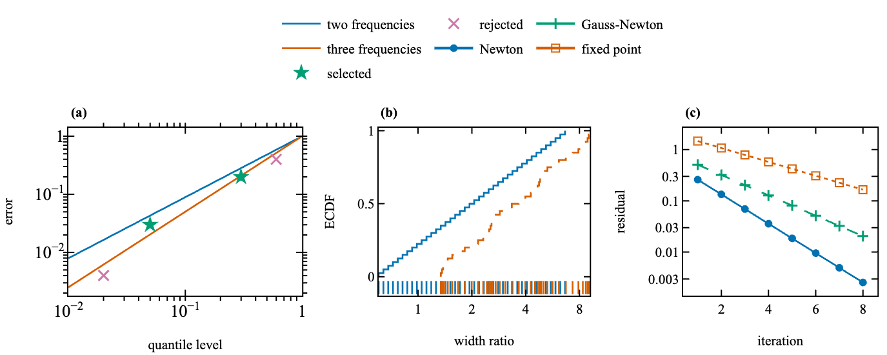

**Replaces (matplotlib):** loglog with '\*'/'X' markers edged white, ax.step(where='post') with ax.vlines below y = 0, LogLocator(subs=(1, 3)) with '{:g}' labels and a figure legend above all panels.

**PlotlySupply:** `plot_ecdf!`, `plot_vlines!`, `yticks!(subs = (1, 3), format = "~g")` and one figure legend.

### `optimization_history`

Optimization histories with fading seeds beside categorical end points with rotated labels. ([script](https://github.com/jake-w-liu/PlotlySupply.jl/blob/main/docs/gallery/optimization_history.jl))

**Replaces (matplotlib):** ax.plot(alpha = 1 - .23 \* seed) with one legend entry per method, set\_xticks + set\_xticklabels + tick\_params(rotation=20), minor log-tick labels on a short axis.

**PlotlySupply:** per-trace `opacity`, an unnamed trace stays out of the legend, `xticks!(...; angle = -20)`, and `yticks!(...; subs = ...)` labels the mantissas of an axis shorter than a decade.

### `sharey_crossover`

Two panels sharing y on a log x axis, hollow samples over limit curves, one legend above. ([script](https://github.com/jake-w-liu/PlotlySupply.jl/blob/main/docs/gallery/sharey_crossover.jl))

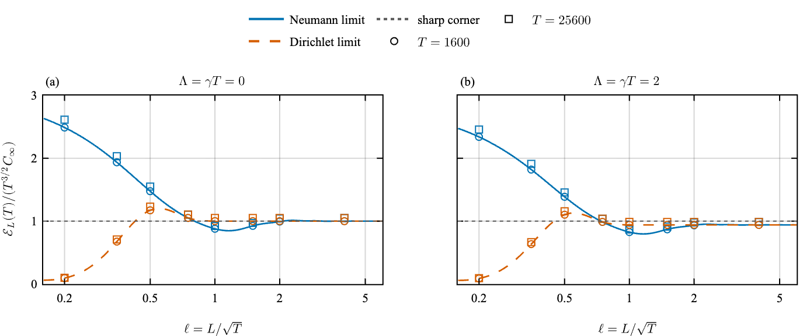

**Replaces (matplotlib):** plt.subplots(sharey=True), set\_xscale('log') with ticks 0.2/0.5/1/2/5, solid and dashed limit curves, hollow circle/square samples, axhline(color='0.35', ls=':'), fig.legend(ncol=3, loc='outside upper center') built from Line2D proxies.

**PlotlySupply:** the matplotlib grey level "0.35" is accepted as a colour, `legend_entry!` builds the proxy entries and `:outside_top` places the legend above the panel titles.

### `band_quasimodes`

Residual decay on a wide semilog axis with a leader label, and a min/max band of four curves. ([script](https://github.com/jake-w-liu/PlotlySupply.jl/blob/main/docs/gallery/band_quasimodes.jl))

**Replaces (matplotlib):** semilogy over 1e-20 .. 1e3, ax.annotate(xytext=..., arrowprops={'arrowstyle': '-'}), fill\_between(alpha=.2) with bounding lines, a multi-line ax.text in axes coordinates, a two-column frameless fig.legend above both panels.

**PlotlySupply:** `yticks = :decades` thins the labels of a 23-decade axis, `annotate!(offset = ...)` draws the leader, `plot_band!` the band, `:outside_top` stacks the legend above the titles.

### `endpoint_star`

Two series with their extrapolated end points drawn as stars. ([script](https://github.com/jake-w-liu/PlotlySupply.jl/blob/main/docs/gallery/endpoint_star.jl))

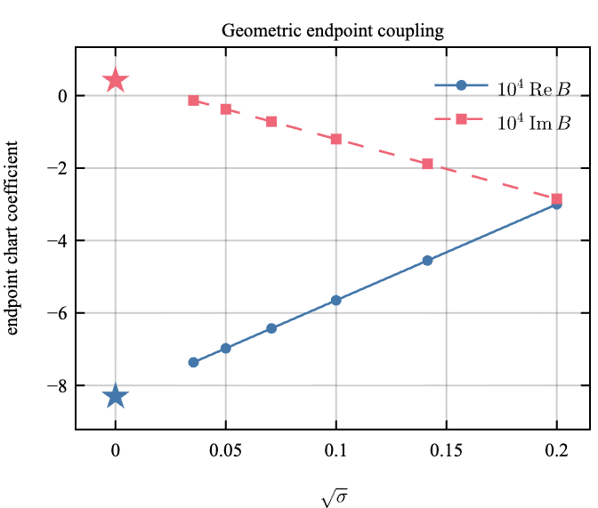

**Replaces (matplotlib):** ax.plot('o-') / ax.plot('s-'), ax.plot(0, B0, '\*', ms=9) in the matching colour, \\operatorname legend labels, explicit ticks, faint grid and a frameless legend.

**PlotlySupply:** multi-series `plot_scatter` with per-series colours and markers, `\operatorname` in math legend entries, the journal preset for fonts and size.

### `poles_scatter`

Poles in the complex plane: filled and hollow markers, a label next to every point. ([script](https://github.com/jake-w-liu/PlotlySupply.jl/blob/main/docs/gallery/poles_scatter.jl))

**Replaces (matplotlib):** ax.scatter with mfc='white', ax.annotate(str(l), xytext=(4, 3), textcoords='offset points'), a note in axes coordinates, y-only grid, open spines, legend top right.

**PlotlySupply:** `marker_symbol = "square-open"`, `annotate!(offset = ...)` in px from the data point, `grid = :y` and `spines!(style = :open)`; the default legend position avoids the points.

### `topo_phase`

A phase-plane schematic with arcs and leader labels, beside a phase-lag plot. ([script](https://github.com/jake-w-liu/PlotlySupply.jl/blob/main/docs/gallery/topo_phase.jl))

**Replaces (matplotlib):** ax.fill under everything, dotted reference radius, FancyArrowPatch arcs, ax.annotate(xytext=..., arrowprops={'arrowstyle': '-'}) labels and white-edged markers.

**PlotlySupply:** `circle!(layer = "below")`, `arc!(arrow = :end)`, `annotate!(xytext = ..., head = ...)` leader lines with a `background`, and `equalar = true`; labels do not overlap the circle or each other.

## Bars, dots and heatmaps

### `log_bars`

Grouped bars on a log y axis beside a line plot with a dotted floor. ([script](https://github.com/jake-w-liu/PlotlySupply.jl/blob/main/docs/gallery/log_bars.jl))

**Replaces (matplotlib):** ax.bar(np.arange(1, 4) + offset, ..., .3), set\_yscale('log') with string tick labels, 'o--' and 's-' lines, a dotted ax.axhline with its own legend entry, hidden top/right spines.

**PlotlySupply:** `plot_bar!` groups series by itself, `yticks = [...]` with labels on a log axis takes data values, `hline!(legend = ...)` adds the floor to the legend, `spines!(style = :open)`.

### `optical_bars`

Horizontal bars on a log axis with conditional value labels, and a stacked power budget. ([script](https://github.com/jake-w-liu/PlotlySupply.jl/blob/main/docs/gallery/optical_bars.jl))

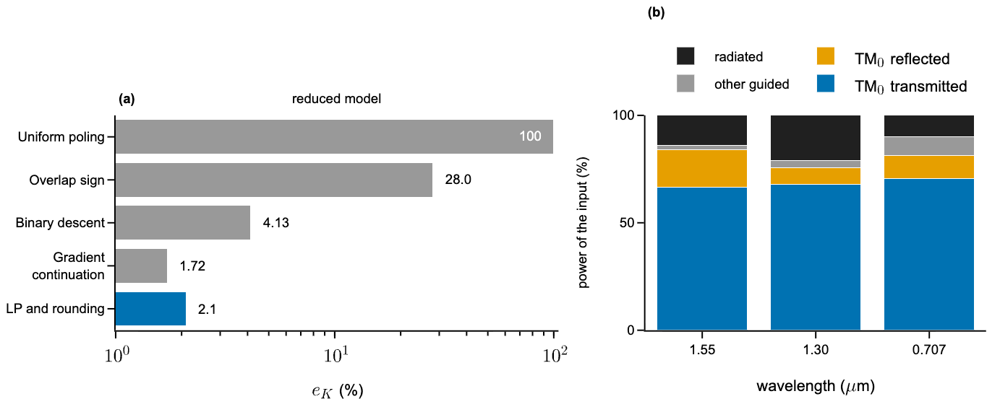

**Replaces (matplotlib):** ax.barh with one highlighted colour, ax.text value labels inside or outside the bar, hidden left spine, ax.bar(bottom=...) stacks and a legend above built from Rectangle handles.

**PlotlySupply:** one `plot_bar!` series per colour, `annotate!(anchor = ...)` for the labels, `barmode = "stack"` for the budget and `:outside_top` for the legend; fonts and spines come from the preset.

### `optical_dots`

Dots at grouped categorical positions: filled and hollow markers, group names under the ticks. ([script](https://github.com/jake-w-liu/PlotlySupply.jl/blob/main/docs/gallery/optical_dots.jl))

**Replaces (matplotlib):** integer x positions with gaps between groups, one tick label per point, group names placed with annotate(xycoords=("data", "axes fraction"), xytext=(0, -12)), dotted nominal lines with a right-aligned grey text and a legend above the axes at the left.

**PlotlySupply:** the group names are a SECOND tick-label row (`secondary_xaxis!(side = :bottom)`), laid out below the tick labels with room reserved; no offsets are computed.

### `param_heatmaps`

Two parameter-space heatmaps with a shared y axis and one colorbar. ([script](https://github.com/jake-w-liu/PlotlySupply.jl/blob/main/docs/gallery/param_heatmaps.jl))

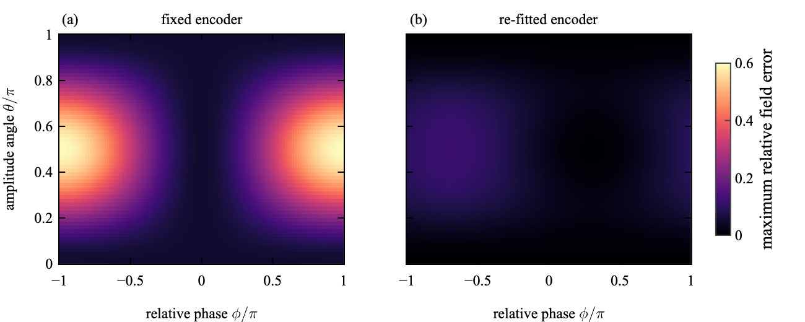

**Replaces (matplotlib):** plt.subplots(1, 2, sharey=True), pcolormesh(vmin=0, vmax=.6) with the default 'auto' aspect, the y label on the left panel only, fig.colorbar(im, ax=axes).

**PlotlySupply:** `equalar = false` keeps matplotlib's auto aspect (the mesh functions default to equal aspect); `shared_yaxes` hides the right panel's tick labels; `shared_colorbar!` draws the bar.

### `topo_annotated_heatmap`

A heatmap with two labels in every cell, beside a log-log companion. ([script](https://github.com/jake-w-liu/PlotlySupply.jl/blob/main/docs/gallery/topo_annotated_heatmap.jl))

**Replaces (matplotlib):** imshow with categorical ticks, ax.text in every cell (white on dark cells, black on light), a colorbar with fixed ticks and a rotated label, width\_ratios with a companion panel.

**PlotlySupply:** `plot_heatmap!(text = ...)` writes the cell labels (the colour of each follows the cell's luminance), `colorbar!(ticks = ...)`, and the categories are the x ticks themselves.

### `optical_cividis`

Cividis maps with outlined holes and one colorbar, a smoothed error map, a log-scaled matrix. ([script](https://github.com/jake-w-liu/PlotlySupply.jl/blob/main/docs/gallery/optical_cividis.jl))

**Replaces (matplotlib):** imshow(origin='lower', extent=...), Rectangle outlines, interpolation='bilinear', ax.contour(levels=\[10\]), LogNorm(1e-4, 1), group labels placed with annotate(xycoords=axes).

**PlotlySupply:** `equalar = true`, `interpolation = :bilinear`, `colornorm = :log`, a SHARED colorbar for the first row, and the group labels as a second tick-label row (`secondary_xaxis!(side = :bottom)`).

*Known limit at the time of writing: the first row of maps sits below a blank band.*

### `topo_pcolormesh`

A diverging strip with a power-of-ten colorbar, log-y cell edges, and a curvilinear cross-section. ([script](https://github.com/jake-w-liu/PlotlySupply.jl/blob/main/docs/gallery/topo_pcolormesh.jl))

**Replaces (matplotlib):** pcolormesh with TwoSlopeNorm(0), pi-fraction x ticks, ScalarFormatter(useMathText), geometric cell edges on a log y axis, pcolormesh on 2-D (rho, z) arrays with set\_aspect('equal').

**PlotlySupply:** `cmid = 0`, `exponentformat = "power"` on the colorbar, `yscale = "log"` with edges, and `plot_pcolormesh!` on node arrays with `equalar = true`.

### `optical_pixelmap`

A binary pixel pattern drawn cell by cell with wave-vector arrows, and the same pattern as image rows. ([script](https://github.com/jake-w-liu/PlotlySupply.jl/blob/main/docs/gallery/optical_pixelmap.jl))

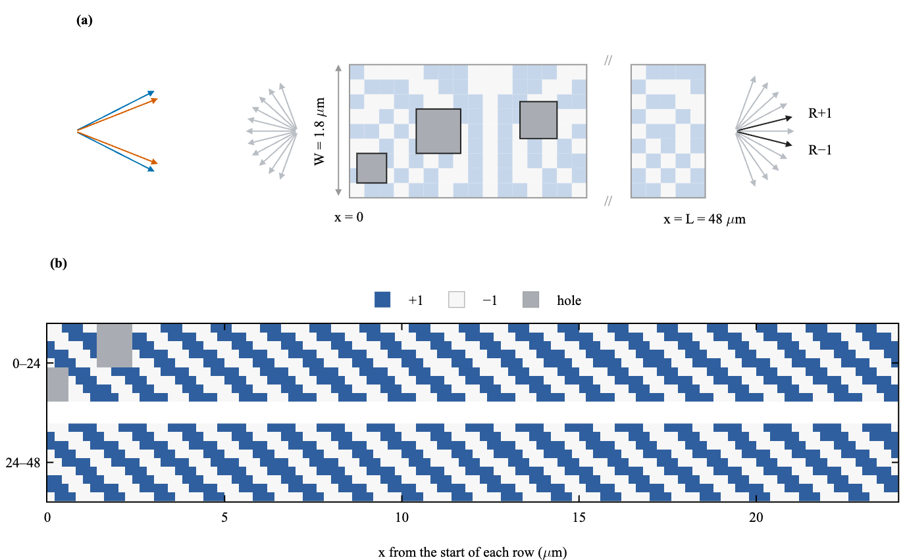

**Replaces (matplotlib):** Rectangle patches per pixel, FancyArrowPatch fans, a rotated '<->' dimension annotation, imshow(cmap=ListedColormap, vmin=-1.5, vmax=1.5), row labels as y ticks, a three-patch legend.

**PlotlySupply:** `rectangle!`/`arrow!` in data units on an `equalar` axis, `discrete_colormap` for the ListedColormap, `plot_heatmap!` on pixel EDGES, `annotate!(textangle = ...)`, patch legend entries.

## Field maps and meshes

### `fig4_waveguide`

A six-panel waveguide figure: signed field, current with streamlines and mode content, two columns. ([script](https://github.com/jake-w-liu/PlotlySupply.jl/blob/main/docs/gallery/fig4_waveguide.jl))

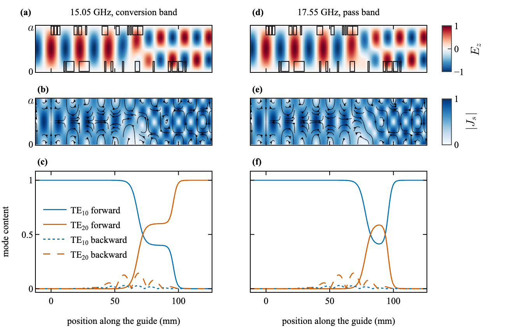

**Replaces (matplotlib):** plt.subplots(3, 2, sharex=True, sharey=True, height\_ratios=\[1, 1, 2.6\]) with imshow, Rectangle outlines, streamplot, one colorbar per row, panel letters and a legend on the left.

**PlotlySupply:** no workaround is needed: the two field rows are tight to the field (no padding from the outlines or streamlines), one `shared_colorbar!` per row, equal aspect where the field is drawn.

### `field_maps`

Stacked intensity maps on a non-uniform grid, one colorbar for all three. ([script](https://github.com/jake-w-liu/PlotlySupply.jl/blob/main/docs/gallery/field_maps.jl))

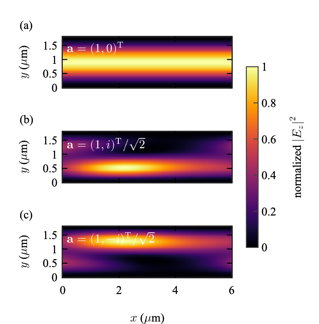

**Replaces (matplotlib):** plt.subplots(3, 1, sharex=True), pcolormesh on quadrature nodes with vmin=0, vmax=1, a white ax.text in axes coordinates, fig.colorbar(im, ax=axes, label=...).

**PlotlySupply:** `plot_pcolormesh!` accepts the non-uniform node vector; `equalar = true` keeps the cells square; `shared_colorbar!` spans the three panels; the figure is sized to the field first.

### `chama_a5_deformed_meshes`

Three deformed FEM quad meshes coloured by a cell value, one shared colorbar. ([script](https://github.com/jake-w-liu/PlotlySupply.jl/blob/main/docs/gallery/chama_a5_deformed_meshes.jl))

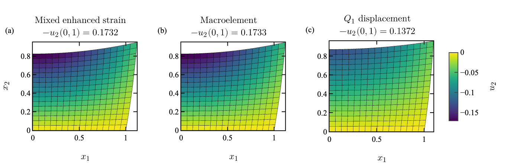

**Replaces (matplotlib):** PolyCollection(cmap=, edgecolors='black', linewidths=.25) with set\_array/clim, set\_aspect('equal'), fig.colorbar(c, ax=list(axes), shrink=.75), two-line mathtext titles.

**PlotlySupply:** `plot_polygons!` takes nodes plus a quad connectivity matrix; `shared_colorbar!` draws one bar of the common colour range, 75 % of the panel height; panels keep their aspect.

### `chama_a6_map_and_curves`

A deformed-mesh field map beside a curve panel, the colorbar bound to the map only. ([script](https://github.com/jake-w-liu/PlotlySupply.jl/blob/main/docs/gallery/chama_a6_map_and_curves.jl))

**Replaces (matplotlib):** fig.add\_subplot(121/122), PolyCollection with clim at the 95th percentile, fig.colorbar(c, ax=ax1, shrink=.85), unequal panel widths in constrained\_layout.

**PlotlySupply:** `width_ratios`, a cell colorbar (`colorbar!(...; row, col)`) that stays inside its own cell, and `xticks = :decades` for the curve panel.

*Known limit at the time of writing: the figure keeps a blank band below the panels.*

### `tripcolor_geometry`

A geometry sketch beside a Gouraud-shaded field on an unstructured triangle mesh. ([script](https://github.com/jake-w-liu/PlotlySupply.jl/blob/main/docs/gallery/tripcolor_geometry.jl))

**Replaces (matplotlib):** ax.tripcolor(shading='gouraud') with a Triangulation mask, Circle / Polygon patches, ax.annotate with a plain leader, white overlay outlines and a shortened colorbar, both panels with set\_aspect('equal').

**PlotlySupply:** `plot_tripcolor!(mask = ...)`, `equalar = true`, `polygon!`/`circle!`, `annotate!(anchor = ...)` and a cell colorbar that is as tall as the fitted plot.

### `mdd_shell_field`

A polar field drawn on a mirrored meridional disk with circles and a text core, beside branches. ([script](https://github.com/jake-w-liu/PlotlySupply.jl/blob/main/docs/gallery/mdd_shell_field.jl))

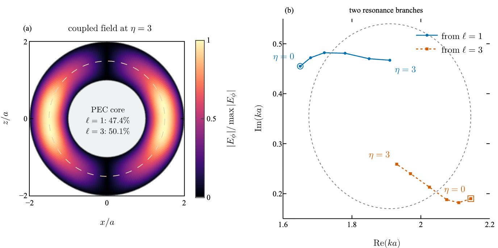

**Replaces (matplotlib):** pcolormesh on a (r, theta) mesh mirrored to a full disk (magma, fixed 0..1), a narrow colorbar, Circle patches, a multi-line ax.text in the core, open/filled branch markers.

**PlotlySupply:** `plot_pcolormesh!` takes the curvilinear node arrays, `equalar = true` keeps the disk round, `annotate!(fit = ...)` sizes the core text to the core, `colorbar!` keeps its bar inside the cell.

### `mesh_timeseries_strip`

A mesh schematic beside a time trace with sampled hollow markers and an energy plot. ([script](https://github.com/jake-w-liu/PlotlySupply.jl/blob/main/docs/gallery/mesh_timeseries_strip.jl))

**Replaces (matplotlib):** PolyCollection of triangles by material, Rectangle patches, ax.plot(t\[::16\], ..., 'o', mfc='none'), ticklabel\_format(style='sci') offset text and a legend placed in axes fractions.

**PlotlySupply:** `plot_polygons!` takes triangle lists, `markevery`, SI/power tick labels carry the exponent (no offset text), and the default legend placement avoids the traces.

## Schematics

### `block_diagram`

A block diagram on hidden axes above a device drawing with shaded design regions. ([script](https://github.com/jake-w-liu/PlotlySupply.jl/blob/main/docs/gallery/block_diagram.jl))

**Replaces (matplotlib):** ax.axis('off'), FancyBboxPatch / FancyArrowPatch, a gridspec row with height\_ratios, axvspan, fill\_between, dotted and solid edges and a legend above the axes.

**PlotlySupply:** `rectangle!(rounded = ...)`, `arrow!`, `annotate!(anchor = ...)`, `vspan!`, `plot_band!`, `panel_labels!`; the legend is stacked above the panel by the layout engine.

### `device_geometry`

A waveguide device schematic with hatched walls, design strips and dimension arrows, then to scale. ([script](https://github.com/jake-w-liu/PlotlySupply.jl/blob/main/docs/gallery/device_geometry.jl))

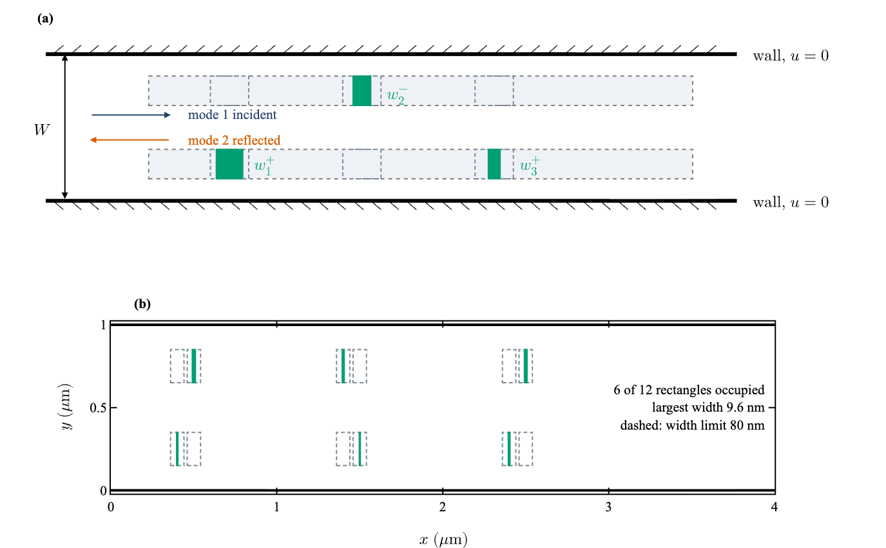

**Replaces (matplotlib):** ax.axis('off') with set\_aspect('equal'), Rectangle patches with dashed edges, a LineCollection of hatch ticks, ax.annotate('<->') dimension arrows and a right-aligned multi-line ax.text.

**PlotlySupply:** `equalar = true`, `rectangle!(layer = "below")`, one `plot_segments!` call for the hatch, `arrow!(head = :both)`, and `annotate!(anchor = ..., align = ...)`; no position arithmetic.

*Known limit at the time of writing: a blank band separates the two rows.*

### `mdd_schematic`

A schematic of circles, arrows and math labels above two data panels. ([script](https://github.com/jake-w-liu/PlotlySupply.jl/blob/main/docs/gallery/mdd_schematic.jl))

**Replaces (matplotlib):** GridSpec(2, 2) with a top cell spanning both columns, ax.axis('off') with set\_aspect('equal'), Circle / FancyArrowPatch patches, ax.text math labels and end-of-curve labels.

**PlotlySupply:** `Spec(colspan = 2)` for the wide cell, `equalar = true` + `axis_off!` for the drawing, `circle!`/`arrow!`, and `annotate!` with `anchor` and `offset` instead of position arithmetic.

## Three-dimensional figures

### `chama_a7_hex_surfaces`

Exterior faces of three deformed hexahedral meshes, coloured by a displacement, one colorbar. ([script](https://github.com/jake-w-liu/PlotlySupply.jl/blob/main/docs/gallery/chama_a7_hex_surfaces.jl))

**Replaces (matplotlib):** fig.add\_subplot(1, 3, i, projection='3d'), Poly3DCollection(cmap=, edgecolors=) with set\_array/clim, view\_init(elev=20, azim=-65), set\_box\_aspect, MaxNLocator(nbins=3), fig.colorbar(coll, ax=axes, shrink=.65).

**PlotlySupply:** scene cells (`Spec(kind = "scene")`), `plot_polygons3d!` with a quad face matrix, `view!` for the camera and `shared_colorbar!`; the scenes are framed to fill their cells.

*Known limit at the time of writing: a 3-D scene fills only part of its grid cell.*

### `chama_a8_geometry_sketch`

A single-colour 3-D geometry sketch with a label at a 3-D point. ([script](https://github.com/jake-w-liu/PlotlySupply.jl/blob/main/docs/gallery/chama_a8_geometry_sketch.jl))

**Replaces (matplotlib):** Poly3DCollection in one colour with black edges, set\_box\_aspect, view\_init, set\_yticks(\[-20, 0, 20\]) and ax.text(48, 5, 60, ' C').

**PlotlySupply:** `plot_polygons3d` with a constant colour, `aspectmode = "data"` for true proportions, `annotate!` with a 3-D position.

### `chama_a9_torus_ghost_mesh`

A torus coloured by a signed displacement over a faint wireframe of the reference mesh. ([script](https://github.com/jake-w-liu/PlotlySupply.jl/blob/main/docs/gallery/chama_a9_torus_ghost_mesh.jl))

**Replaces (matplotlib):** Line3DCollection (ghost edges) under a Poly3DCollection with cmap='coolwarm' and a symmetric clim, view\_init(elev=65, azim=-70), a hand-placed colorbar axes.

**PlotlySupply:** `scene!` fixes equal axes, `plot_segments3d!` draws the ghost mesh, `plot_polygons3d!` takes a diverging scale with a symmetric `crange`, and `shared_colorbar!` draws the bar.

*Known limit at the time of writing: a 3-D scene fills only part of its grid cell.*

### `mdd_slices`

Three horizontal slices of a field in a unit cube, with the cube wireframe and a vector arrow. ([script](https://github.com/jake-w-liu/PlotlySupply.jl/blob/main/docs/gallery/mdd_slices.jl))

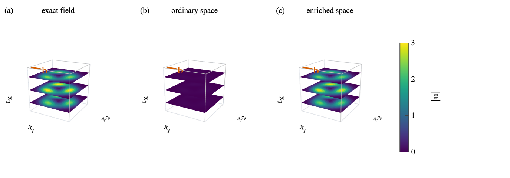

**Replaces (matplotlib):** add\_subplot(projection='3d'), Poly3DCollection of slice triangles coloured by |u|, Line3DCollection cube edges, ax.quiver, hidden ticks and one external colorbar.

**PlotlySupply:** `plot_polygons3d!` takes triangles as well as quads, `plot_segments3d!` the edges, `plot_quiver3d!` the arrow; `shared_colorbar!` gives one bar for the three scenes.

### `topo_cutplanes`

Three orthogonal cut planes through a unit cube in two scenes, one shared colorbar. ([script](https://github.com/jake-w-liu/PlotlySupply.jl/blob/main/docs/gallery/topo_cutplanes.jl))

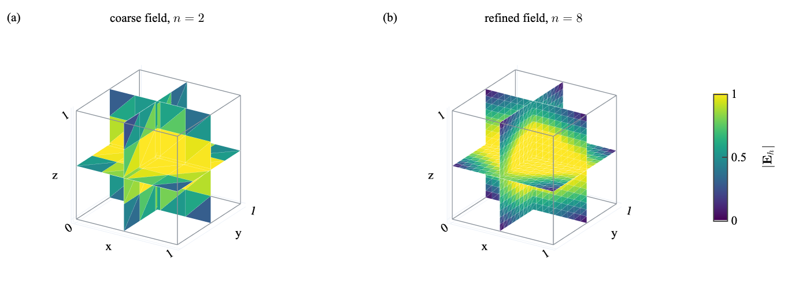

**Replaces (matplotlib):** Poly3DCollection of triangles coloured per face, white cell outlines, a Line3DCollection cube, ticks only at 0 and 1, hidden panes, orthographic view\_init(24, -58), one side colorbar.

**PlotlySupply:** `plot_polygons3d!` takes a list of triangles with one value each, `coloraxis = :shared` makes one colour scale for both scenes, `view!(projection = "orthographic")`, `colorbar!(coloraxis = :shared)`.

### `topo_whitney`

Whitney basis functions on a reference tetrahedron: edges, a face, vector fields and a normal. ([script](https://github.com/jake-w-liu/PlotlySupply.jl/blob/main/docs/gallery/topo_whitney.jl))

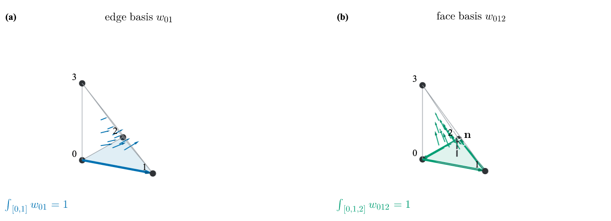

**Replaces (matplotlib):** orthographic 3-D axes with axis off, grey edges, a translucent face, ax.quiver of small arrows, custom Arrow3D (FancyArrowPatch) for oriented edges, a bold n label, text2D captions.

**PlotlySupply:** `plot_quiver3d!(style = :arrow)` for every arrow, `view!(projection = "orthographic")`, `scene!(showaxis = false)`, `annotate!` in 3-D and axes-fraction captions.

*Known limit at the time of writing: a 3-D scene fills only part of its grid cell.*

### `topo_response`

An analytic response surface with 3-D curves and samples, beside an equal-aspect ellipse. ([script](https://github.com/jake-w-liu/PlotlySupply.jl/blob/main/docs/gallery/topo_response.jl))

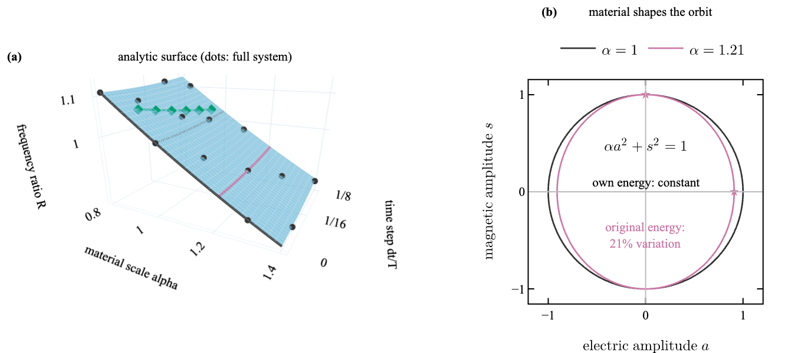

**Replaces (matplotlib):** plot\_surface (one colour, alpha, light edges) with ax.plot curves and ax.scatter samples in 3-D, fraction tick labels, box aspect (1.3, 1, .85), view\_init(24, -61), and a 2-D orbit ellipse with text lines and a two-column legend above the axes.

**PlotlySupply:** `plot_surface!(color = ..., edges = true)`, `plot_scatter3d!`, `scene!(yticklabels = ...)`, `view!`; in 3-D, axis titles are plain text (WebGL cannot typeset TeX); the 2-D panel stacks its legend above the title by itself.

## Layouts and export for journals

### `optical_reach`

Two stacked panels sharing x beside one tall panel, with titled legends and offset labels. ([script](https://github.com/jake-w-liu/PlotlySupply.jl/blob/main/docs/gallery/optical_reach.jl))

**Replaces (matplotlib):** GridSpec(2, 2, width\_ratios=\[1.3, 1\]) with a spanning panel, a LinearSegmentedColormap ramp sampled per line, ax.annotate(xytext=(-5, 4), textcoords='offset points'), fill\_between and a diagonal reference line, one titled legend per panel.

**PlotlySupply:** `Spec(rowspan = 2)`, `colormap_colors` for the ramp, `annotate!(offset = ...)`, `plot_band!`; the left panels get a one-row titled legend above them (`position = :outside_top`), the default legend of the right panel avoids its data.

### `journal_export`

A two-panel figure at a journal's text width, exported tight and byte-identical. ([script](https://github.com/jake-w-liu/PlotlySupply.jl/blob/main/docs/gallery/journal_export.jl))

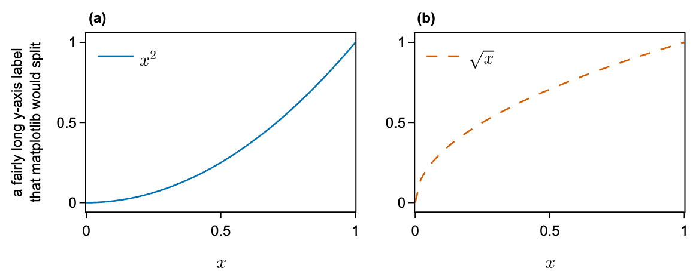

**Replaces (matplotlib):** figure sizes in inches, bold left-aligned panel letters, bbox\_inches='tight', a long y label that matplotlib splits over lines, and stripping PDF dates so that repeated builds are identical.

**PlotlySupply:** a journal preset, `figsize!(fig, 153, 60; units = :mm)` (any width, here the text width of an Elsevier-style two-column layout), `panel_labels!`, long labels wrapped by the layout engine, `savefig(...; tight = true)` and deterministic exports by default.
