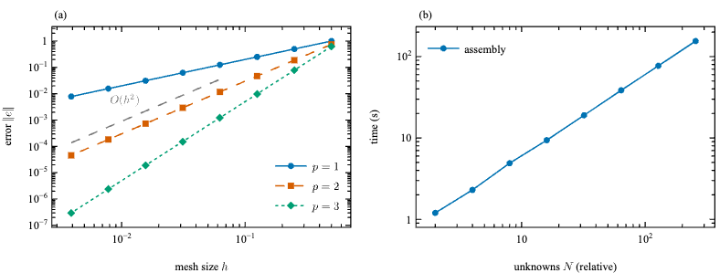
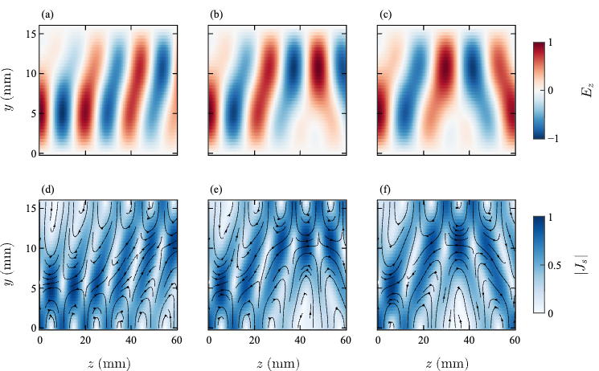
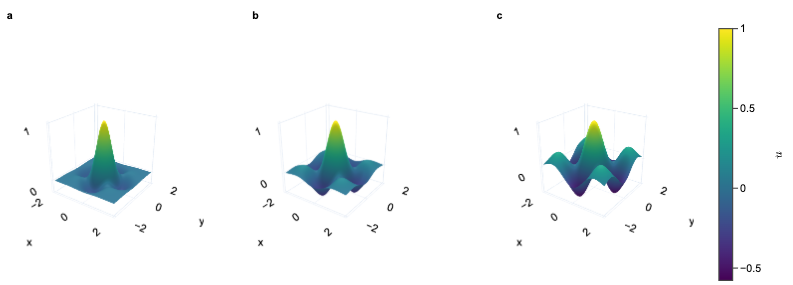
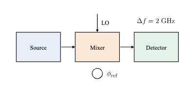

# Figures for papers

This page goes from data to a camera-ready file: pick the journal's preset,
size the figure in the journal's units before drawing, draw, and export in the
format the publisher asks for. Four complete examples follow: a convergence
plot, a field-map figure, a row of 3-D surfaces and a schematic.

## 1. The short path

A journal preset sets the fonts (in points), line and tick weights, the
colour-blind-safe colours and the default figure width of that journal's single
column. `savefig` without a size uses that width, so this is a complete
camera-ready file:

```julia
using PlotlySupply

t = range(0, 10; length = 200)
fig = with_style(:ieee) do
    plot_scatter(t, [sin.(t), cos.(t)]; legend = ["\$\\sin t\$", "\$\\cos t\$"],
        xlabel = "time \$t\$ (s)", ylabel = "signal")
end
savefig(fig, "signal.pdf")        # 3.5 in x 2.625 in page, Times New Roman embedded
```

[`with_style`](@ref) applies a style to the figures built inside it;
[`set_default_style!`](@ref)`(:ieee)` applies it to the whole session. A
figure keeps the style it was built with.

## 2. Journal presets

| Preset | Text | Single column | Double column | Frame and ticks | Source of the numbers |
|---|---|---|---|---|---|
| `:ieee` | Times New Roman 8 pt | 3.5 in | 7.16 in | box, inside ticks on all four sides | IEEE Author Center |
| `:aps` | Times 9 pt | 8.6 cm | 17.2 cm | box, inside ticks on all four sides | APS Physical Review |
| `:nature` | Arial 7 pt | 89 mm | 183 mm (max. height 170 mm) | left and bottom axes, outside ticks | Nature research figure guide |
| `:elsevier` | Arial 9 pt | 90 mm | 190 mm (1.5 columns: 140 mm) | box, outside ticks | Elsevier artwork sizing |
| `:springer` | Helvetica 8 pt | 84 mm | 174 mm (1.5 columns: 129 mm; max. height 234 mm) | box, outside ticks | Springer instructions for authors |
| `:aip` | Times 8 pt | 3.37 in | 6.69 in (max. height 8.25 in) | box, inside ticks on all four sides | AIP Publishing author instructions |

Every preset sets all text roles to the size in the table, a 1 pt data line,
0.75 pt axis, tick, error-bar and reference lines, 3.5 pt ticks, 6 px markers,
the Okabe-Ito colours and the greyscale-safe `:dash_symbol` cycle (line series
differ by dash pattern, marked series by dash and symbol), and a figure width
equal to the single column at aspect ratio 0.75. [`journal_width`](@ref)
documents each number with its source:

```julia
journal_width(:ieee; columns = 2)                       # 7.16 (inches)
journal_width(:nature; columns = 2, units = :mm)        # 183.0
```

Optica is not included: its figure widths could not be confirmed from Optica's
own guidelines. For a journal that is not in the table, register a
[`PlotStyle`](@ref) with its numbers (sizes in px, 1 pt = 4/3 px):

```julia
pt = 96 / 72
register_style!(:mypaper, PlotStyle(; font_family = "Times New Roman, Times, serif",
    font_color = "#000000", fontsize = 9pt, title_fontsize = 9pt, label_fontsize = 9pt,
    tick_fontsize = 8pt, legend_fontsize = 8pt, linewidth = 1.5, axis_linewidth = 0.75pt,
    tick_length = 3.5pt, marker_size = 6, colorway = :okabe_ito, cycle = :dash_symbol,
    legend_frame = false, width = 3.4 * 96, aspect = 0.7, margin = 4))
```

Text in the presets is Times or Arial/Helvetica (TrueType), so PDF export
embeds real fonts (section 7). APS and AIP do not name a font; the choice of
Times is the package's.

## 3. Size first, then draw

Decide the printed size before adding content: equal-aspect fields, colorbar
lengths, legend positions and the gaps between panels are laid out for the size
the figure has when each call runs.

- A new figure takes the style's width and aspect. For another column count
  size the figure right after creating it:
  `figsize!(fig, :ieee; columns = 2, aspect = 0.4)` (or `height = 3`,
  `units = :in`); an explicit `width`/`height` keyword of the constructor or of
  [`subplots`](@ref) does the same, as in the examples below, which take the
  width from [`journal_width`](@ref)`(...; units = :px)`.
- A journal with a maximum height rejects a taller figure
  (`ArgumentError`).
- `figsize!` stores the exact size (89 mm is 336.38 px, not 336).
  `savefig(fig, "f.pdf")` exports at that size.
- Exporting at another size rescales nothing: text stays in points and the plot
  area changes.

## 4. Example: convergence plot

Two panels, log-log, reference slope, legend, panel labels, at the IEEE double
column width:

```julia
h = 0.5 ./ 2 .^ (0:7)
errs = [2.0 .* h, 3.0 .* h .^ 2, 5.0 .* h .^ 3]
runtime = [1.2, 2.3, 4.9, 9.4, 19.0, 38.5, 77.0, 155.0]
w = journal_width(:ieee; columns = 2, units = :px)
fig_conv = with_style(:ieee) do
    sf = subplots(1, 2; sync = false, width = w, height = 0.38w)
    plot_scatter!(sf, h, errs; row = 1, col = 1, xscale = "log", yscale = "log",
        mode = "lines+markers",
        legend = ["\$p=1\$", "\$p=2\$", "\$p=3\$"],
        xlabel = "mesh size \$h\$", ylabel = "error \$\\|e\\|\$")
    slope_guide!(sf, 2; row = 1, col = 1, x = (h[end], h[2]),
        through = (h[4], 0.1 * errs[2][4]), label = "\$O(h^2)\$")
    plot_scatter!(sf, 1 ./ h, runtime; row = 1, col = 2, xscale = "log", yscale = "log",
        mode = "lines+markers",
        legend = "assembly", xlabel = "unknowns \$N\$ (relative)", ylabel = "time (s)")
    panel_labels!(sf; labels = :abc, format = "({})")
    sf
end
savefig(fig_conv, "convergence.pdf")
```



The legend is placed where it covers the least data; ranges are data values on
the log axes. Under a paper style a log axis that spans two decades or more
labels powers of ten only by itself (`PlotStyle.log_ticks = :decades`, set by
`:publication` and every journal preset), so `xticks = :decades` is not needed;
under `:default`, plotly's labels, "2" and "5" between the decades, stay unless
they would collide at the figure's size.

## 5. Example: field maps with shared colorbars

A 2 x 3 figure at the APS double column width: the signed field in the top row
(diverging map centred on zero), the current magnitude with its streamlines in
the bottom row, one colorbar per row, panel labels. Axes that carry a field fit
the field exactly:

```julia
a = 15.8
x = range(0, 60; length = 241)
y = range(0, a; length = 41)
# U[ix, iy] at (x[ix], y[iy]): a TE10 + TE20 mixture at three frequencies
function modes(k1, k2)
    Ez = [sin(pi * yj / a) * cos(k1 * xi) + 0.6 * sin(2pi * yj / a) * cos(k2 * xi) for xi in x, yj in y]
    Jx = [sin(pi * yj / a) * sin(k1 * xi) + 0.6 * sin(2pi * yj / a) * sin(k2 * xi) for xi in x, yj in y]
    Jy = [0.7 * cos(pi * yj / a) * cos(k1 * xi) + 0.5 * cos(2pi * yj / a) * cos(k2 * xi) for xi in x, yj in y]
    return Ez ./ maximum(abs, Ez), Jx, Jy
end
w = journal_width(:aps; columns = 2, units = :px)
fig_fields = with_style(:aps) do
    sf = subplots(2, 3; sync = false, width = w, height = 0.62w,
        shared_xaxes = true, shared_yaxes = true)
    for (c, (k1, k2)) in enumerate(((0.30, 0.34), (0.26, 0.33), (0.22, 0.31)))
        Ez, Jx, Jy = modes(k1, k2)
        plot_heatmap!(sf, x, y, Ez; row = 1, col = c, colorscale = "RdBu_r",
            zrange = (-1, 1), grid = false)
        Jmag = hypot.(Jx, Jy)
        plot_heatmap!(sf, x, y, Jmag ./ maximum(Jmag); row = 2, col = c,
            colorscale = "Blues", zrange = (0, 1), grid = false)
        plot_streamlines!(sf, x, y, Jx, Jy; row = 2, col = c, color = "black",
            linewidth = 0.6, density = 0.8, arrowsize = 4)
        xlabel!(sf, "\$z\$ (mm)"; row = 2, col = c)
    end
    ylabel!(sf, "\$y\$ (mm)"; row = 1, col = 1)
    ylabel!(sf, "\$y\$ (mm)"; row = 2, col = 1)
    shared_colorbar!(sf; cells = [(1, 1), (1, 2), (1, 3)], title = "\$E_z\$", title_side = :right)
    shared_colorbar!(sf; cells = [(2, 1), (2, 2), (2, 3)], coloraxis = "coloraxis2",
        title = "\$|J_s|\$", title_side = :right)
    panel_labels!(sf; labels = :abc, format = "({})")
    sf
end
savefig(fig_fields, "fields.pdf")
```



For vectors drawn as glyphs instead of streamlines use
[`plot_quiver`](@ref) (arrows or triangles, see [2-D fields](fields.md)). An
overlay whose anchor points lie inside the field does not widen its axes: the
anchor points count, not the length of the arrows, so arrows that leave the
frame are clipped at it; use `pivot = :tip` or an explicit `xrange`/`yrange` to
show them whole.

## 6. Example: a row of 3-D surfaces with one colorbar

Three scenes at the Nature double column width; the surfaces share one colour
scale (`shared_coloraxis = true`) and one colorbar. Scenes of equal cells and
equal box proportions are framed alike by the automatic camera, so nothing
has to be set for them to be drawn at the same size.

```julia
xs = range(-2, 2; length = 61)
surf(a) = [exp(-(x^2 + y^2) / a) * cos(2x) * cos(2y) for x in xs, y in xs]   # Z[ix, iy]
w = journal_width(:nature; columns = 2, units = :px)
fig_surf = with_style(:nature) do
    sf = subplots(1, 3; sync = false, width = w, height = 0.36w,
        specs = fill(Spec(kind = "scene"), 1, 3))
    for (c, a) in enumerate((1.0, 2.0, 4.0))
        plot_surface!(sf, xs, xs, surf(a); row = 1, col = c, shared_coloraxis = true,
            xlabel = "\$x\$", ylabel = "\$y\$", zlabel = "\$u\$", colorscale = "viridis", aspectmode = "cube")
        view!(sf; row = 1, col = c, elev = 25, azim = -55)
    end
    colorbar!(sf; coloraxis = :shared, title = "\$u\$", title_side = :right)
    panel_labels!(sf; labels = :abc, format = "{}", bold = true)
    sf
end
savefig(fig_surf, "surfaces.pdf")
```



Scene axis titles and tick labels are drawn by WebGL and cannot typeset TeX:
`$x$` becomes the plain letter. The automatic camera distance keeps the box,
its tick labels and its axis titles inside the cell and fills it; the three
scenes get the same distance. A `distance` you give with `view!` is kept as
given and also restores plotly's own label offsets and axis titles: use it
only for a deliberate common camera.

## 7. Example: a schematic with annotations

Shapes are in data units, so draw on an axis with `equalar = true` and switch
the axes off. `annotate!` places text in data, axes, paper or figure
coordinates and can box it, anchor it and size it to a shape:

```julia
fig_schem = with_style(:ieee) do
    fig = plot_scatter(Float64[], Float64[]; xrange = (0, 12), yrange = (0, 5), equalar = true)
    figsize!(fig, :ieee; columns = 1, aspect = 0.5)
    rectangle!(fig, 0.5, 1.5, 3.5, 3.5; fillcolor = "#e8eef7", label = "Source")
    rectangle!(fig, 4.5, 1.5, 7.5, 3.5; fillcolor = "#fbe9d7", label = "Mixer")
    rectangle!(fig, 8.5, 1.5, 11.5, 3.5; fillcolor = "#e3f3ea", label = "Detector")
    arrow!(fig, 3.5, 2.5, 4.5, 2.5)
    arrow!(fig, 7.5, 2.5, 8.5, 2.5)
    arrow!(fig, 6, 4.8, 6, 3.5)
    annotate!(fig, 6.2, 4.15, "LO"; anchor = :left, showarrow = false)
    circle!(fig, 6, 0.7, 0.35)
    annotate!(fig, 6.6, 0.7, "\$\\phi_\\mathrm{ref}\$"; anchor = :left, showarrow = false)
    annotate!(fig, 10, 4.3, "\$\\Delta f = 2\\ \\mathrm{GHz}\$"; showarrow = false,
        background = "white")
    axis_off!(fig)
    fig
end
savefig(fig_schem, "schematic.pdf")
```



## 8. Export for the publisher

```julia
savefig(fig_conv, "fig1.pdf")                          # vector, exact page size
savefig(fig_conv, "fig1.tif"; dpi = 600)               # raster, LZW, 600 dpi tags
savefig(fig_conv, "fig1.png"; dpi = 300)
savefig(fig_conv, ["fig1.svg", "fig1b.pdf"])           # several files, one render
```

```julia
# fragment: needs Ghostscript (gs) on PATH
savefig(fig_conv, "fig1.eps")                          # vector, text as outlines
```

| Format | What you get |
|---|---|
| PDF | Vector, page of exactly the figure's size in points (7.16 in is 515.52 pt). Text stays text in subset-embedded TrueType (CID) fonts when the figure's fonts are TrueType (Times New Roman, Arial, Liberation, DejaVu, ...). STIX or Latin Modern text would be Type 3, which many journal checks reject: with `fonts = :auto` (default) all text of such a page is then converted to outlines through Ghostscript (not selectable), or kept with a warning when `gs` is missing; a single label with a glyph that falls back to a system font (a dingbat such as ✓, some arrows, emoji) has the same effect, so keep to symbols of the figure's font. `fonts = :embed` keeps Chromium's fonts, `fonts = :outline` always outlines. Math is drawn as glyph paths. |
| EPS | Vector through Ghostscript, `%%BoundingBox` is the page. Text is outlined (no fonts in the file) unless `fonts = :embed`. EPS has no transparency: translucent colours are blended over their background; a translucent mark over another mark covers it, so use PDF for overlapping translucent layers. |
| TIFF (`.tif`, `.tiff`) | Baseline TIFF 6.0, lossless LZW, 8-bit RGB (RGBA with unassociated alpha for a translucent background), resolution tags set. 300 dpi unless `dpi` or `scale` says otherwise. |
| PNG, JPEG | Exactly `round(width * scale)` pixels; `dpi` records the resolution (`dpi = 300` on a 3.5 in figure gives 1050 px). With physical sizes and no `dpi`, 96 x `scale` dpi is recorded. Under a journal preset (a style with a physical size) and with neither `dpi` nor `scale`, the default is 300 dpi, as for TIFF. JPEG is lossy (quality 0.92). |
| SVG | With physical units the root `width`/`height` carry the unit (`88mm`); text is `<text>` in the figure's font (not embedded); math is glyph paths. |

Exports are deterministic (`deterministic = true`): repeated exports are
byte-identical. The figure you pass is never modified. See [Export](export.md)
for every keyword.

The files of the convergence example (`fig_conv`, 7.16 in wide) check out
with the usual tools: `pdfinfo fig1.pdf` gives a page of 515.52 x 195.9 pt,
`pdffonts fig1.pdf` lists only embedded CID TrueType subsets of Times New
Roman (no Type 3), and `fig1.tif` is 4296 x 1632 pixels at 600 dpi.

## 9. Fonts, math and sizes in points

- The presets already set the sizes. To change them, use
  `set_fonts!(fig; label = 9, tick = 8, legend = 8, units = :pt)`.
<!-- PENDING D24 -->
- Under the presets (every style with a width) the gap between the tick
  labels and the axis title is half an em of the title font on every axis
  (`PlotStyle.title_gap = 0.5`, in em), for plain, math, wrapped and
  multi-line titles; `title_gap = nothing` keeps plotly's placement, as
  `:default` and `:publication` do, and a `title_standoff` you set wins.
<!-- /PENDING -->
- Text and math share a label: `"time \$t\$ (s)"`. MathJax typesets the math in
  Latin Modern by default; `set_default_mathtext!(; font = "STIX-Web")` and the
  other MathJax fonts are listed under [`savefig`](@ref).
- Scene (3-D) axis titles cannot typeset TeX; their `$...$` is converted to
  Unicode.
- Under `:nature` a log-axis exponent is drawn at 70 % of 7 pt, below
  Nature's 5 pt minimum for superscripts; check the exponents when the
  figure is shrunk.

## 10. Colour and greyscale

- The presets use the Okabe-Ito palette (`PlotlySupply.COLOR_CYCLES[:okabe_ito]`) in an
  order whose first colours read well as thin lines. Other colour-blind-safe
  cycles: `:tol_bright`, `:tol_vibrant`, `:tol_muted`, `:tol_high_contrast`
  (`colorway = :tol_bright` in a [`PlotStyle`](@ref)).
- A figure that may be printed in grey must not rely on colour: the presets'
  `:dash_symbol` cycle varies the dash pattern and marker symbol per series.
  `:bw` draws everything in one ink colour with a dash cycle.
- Colour maps: the perceptually uniform sequential maps (`viridis`, `plasma`,
  `inferno`, `magma`, `cividis`) and the ColorBrewer sequentials (`Greys`,
  `Blues`, `YlOrRd`, ...) keep their order in a black-and-white print.
  Diverging maps (`RdBu_r`, `coolwarm`, with `cmid = 0`) lose the sign in
  greyscale: add contour lines or annotations when the figure must print in
  grey. Avoid `jet`, `rainbow` and `turbo`. The
  [`COLORMAPS`](@ref PlotlySupply.COLORMAPS) table says which map is uniform
  and which is greyscale-safe.
- Colour scale names follow matplotlib's orientation (`"RdBu"` runs red to
  blue, `"Blues"` light to dark); see [Migrating from 1.x](migration.md).

## 11. What moves when you add a decoration

A colorbar, an outside legend, a panel title, a panel label and a secondary
axis each take room from the cell they belong to, or from the figure margin,
never from a neighbouring panel: the cell's plot area shrinks on that side
(cells that share the grid edge shrink alike, by at most two thirds of the cell). A
figure that already fits is not changed; explicit domains, legend positions
and colorbar `x`/`y` that you set are kept; repeating a call gives the same
figure. See [Subplots](subplots.md) for the details and the exceptions.

## Checklist before submission

| Journals reject | Check |
|---|---|
| Text too small after the figure is scaled to the column | Use the journal preset and export at its size: tick labels are 7 to 9 pt. |
| Raster line art, or rasters below the required resolution | Vector PDF/EPS for plots; `dpi = 300` (halftones) or `600` to `1200` (line art) for TIFF/PNG. |
| Type 3 fonts in the PDF | Check with `pdffonts fig.pdf`; keep TrueType fonts (the presets do) or leave `fonts = :auto`. |
| Information carried by colour alone | Okabe-Ito colours with the `:dash_symbol` cycle; direct labels. |
| Axis labels without quantities and units | `"time \$t\$ (s)"`, `"\$E\$ (V/m)"`. |
| Inconsistent fonts and sizes between figures | One style for the whole paper (`set_default_style!(:ieee)`). |
| Missing or inconsistent panel labels | `panel_labels!` on every multi-panel figure. |
| Legends or labels covering data | The default legend avoids data; `set_legend!` with an outside position otherwise. |
| Wrong page size in the PDF | `pdfinfo figure.pdf` shows the page size; it equals `figsize!`/`width x height` exactly. |
